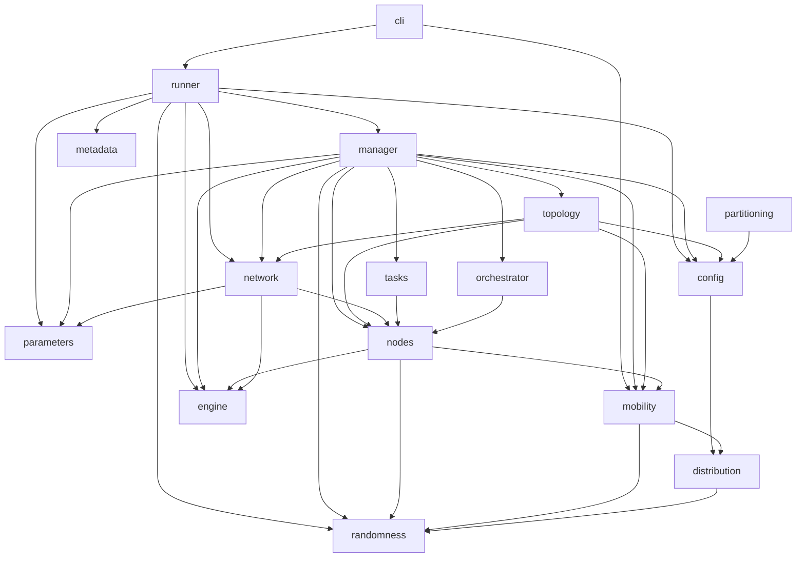

# Architecture

The package `pureedgesim` is a flat set of modules under `src/pureedgesim/`. There is no nested sub-package; the public names are re-exported from `pureedgesim/__init__.py`, so `from pureedgesim import Simulation` works for anything in the `__all__` list.

## Modules

| Module | Role |
| --- | --- |
| `engine` | The discrete-event core: `Engine`, `Event`, `FutureQueue`, `SimEntity`. |
| `randomness` | `Randomness`, one reproducible random stream per thread derived from a single seed. |
| `distribution` | Sixteen probability distributions and `DistributionFactory` / `distribution_from_element`. |
| `parameters` | `SimulationParameters` (a dataclass) and `load_parameters`, the properties parser, plus `validate`. |
| `config` | The XML parsers (`load_settings`) and the data models `Application`, `Subtask`, `DatacenterSpec`, `DeviceSpec`, `ScenarioFiles`. |
| `mobility` | `Location`, `MobilityModel` and its nine subclasses, `MobilityModelFactory`. |
| `nodes` | `ComputingNode` and its subclasses, `EnergyModelComputingNode`, the `NodeType`, `NodeStatus`, `EventType` enums. |
| `network` | `NetworkLink`, `TransferProgress`, `InfrastructureGraph`, `DefaultNetworkModel`, `LinkType`, `LinkTechnology`. |
| `topology` | `ComputingNodesGenerator` (instances from specs) and `DefaultTopologyCreator` (links). |
| `tasks` | `Task`, `TaskStatus`, `DefaultTaskGenerator` (the pre-generated workload). |
| `orchestrator` | `Orchestrator` and `DefaultOrchestrator`, the placement policy. |
| `manager` | `SimulationManager` and `Scenario`; the hub that owns the models and drives the lifecycle. |
| `runner` | `Simulation`, `run_scenario`, `build_scenarios`, `summarize`, and the `COLUMNS` list. |
| `partitioning` | `ServiceGraph`, `GraphPartitioner`, `GeneticPartitioner`, used by the examples. |
| `metadata` | `write_run_metadata`, provenance and the settings snapshot. |
| `cli` | The `pureedgesim` command entry point. |

## Module dependencies

The dependency direction is strictly downward. `manager` is the hub that wires the runtime models together; `runner` drives the sweep; nothing imports `runner` back.



`randomness`, `engine`, and `parameters` sit at the bottom and depend on the standard library only; `distribution` adds just `randomness`. `partitioning` is a leaf used by the examples; the core simulation never imports it.

## The event engine

`Engine` holds a `FutureQueue`, a heap of `Event` objects ordered by `time`. Each `Event` carries a `destination` (a `SimEntity`), an integer `tag`, and an arbitrary `data` payload. Tie-breaking is by an insertion `serial`, so two events at the same time run in the order they were scheduled; this keeps a seeded run deterministic.

A `SimEntity` is anything that receives events. It registers itself with the engine on construction and implements `process_event`. The lifecycle hooks `on_simulation_start` and `on_simulation_end` run before and after the loop.

```python
from pureedgesim import Engine, SimEntity

class Counter(SimEntity):
    def __init__(self, engine, target):
        super().__init__(engine)
        self.count = 0
        self.target = target

    def on_simulation_start(self):
        self.schedule(self, 1.0, 0, None)   # first event one second from now

    def process_event(self, event):
        self.count += 1
        if self.count < self.target:
            self.schedule(self, 1.0, 0, None)

engine = Engine(duration=100.0)
counter = Counter(engine, target=5)
engine.start()
print(counter.count)   # 5
```

`engine.start()` resets the clock to 0, fires `on_simulation_start` on every entity, then pops events in time order until the queue is empty or something calls `engine.terminate()`. The clock moves to each event's time as it is processed. `Engine.clock_in_minutes()` is a convenience accessor.

The `Engine` constructor takes the simulation duration, but the engine itself does not stop at that time. Stopping is the manager's job: the manager schedules a `PRINT_LOG` event at `simulation_duration` and decides there whether to terminate or to keep waiting for in-flight tasks (see [Task lifecycle](task-lifecycle.md)).

## Who is a SimEntity

Four runtime classes extend `SimEntity` and therefore receive events directly:

- `SimulationManager`, the hub. Its tags are `SEND_TO_ORCH`, `NEXT_BATCH`, `SEND_TASK_FROM_ORCH_TO_DESTINATION`, `RESULT_RETURN_FINISHED`, and `PRINT_LOG`.
- `ComputingNode`. Its tags are `UPDATE_STATUS` (the periodic mobility, energy, and battery tick) and `EXECUTION_FINISHED`.
- `DefaultNetworkModel`. Its tag is `UPDATE_NETWORK`, the transfer-progress tick that shares link bandwidth.
- Mobility is not an entity. Paths are precomputed once at startup, so nodes do not schedule movement events.

## How a run is assembled

`Simulation.launch()` builds the scenario sweep and, for each scenario, runs one iteration:

1. `build_scenarios` produces the cross product of architectures, algorithms, and device counts.
2. For each scenario, `run_scenario` seeds `Randomness`, creates a fresh `Engine` and `SimulationManager`, and calls `manager.start_simulation()`.
3. `start_simulation` constructs the network model, the nodes generator (which instantiates cloud, edge, and device nodes from the specs), the topology (which lays down the links), and the orchestrator, then pre-generates the whole workload.
4. The manager schedules the first batch of root tasks and the termination check, then `engine.start()` runs the event loop.
5. `summarize(manager)` turns the accumulated counters into one result dict, which `runner` appends to the CSV.

In parallel mode the iterations run in a `concurrent.futures.ProcessPoolExecutor` (up to 8 workers). Each worker re-derives the same random stream from the seed and the scenario index, so a parallel run produces the same rows as a sequential one. See the parallel notes in [Python vs Java](python-vs-java.md).

## Extension points

`start_simulation` builds each of the classes above through a hook on `SimulationManager`, and `Simulation` exposes one setter per hook. Every setter returns the simulation, so they chain like the Java ones.

| Setter | Replaces | Constructor it calls |
| --- | --- | --- |
| `set_custom_mobility_model` | `DefaultMobilityModel` | `(manager, location)` |
| `set_custom_orchestrator` | `DefaultOrchestrator` | `(manager)` |
| `set_custom_network_model` | `DefaultNetworkModel` | `(manager)` |
| `set_custom_computing_nodes_generator` | `ComputingNodesGenerator` | `(manager)` |
| `set_custom_topology_creator` | `DefaultTopologyCreator` | `(manager, generator, files)` |
| `set_custom_task_generator` | `DefaultTaskGenerator` | `(manager)` |
| `set_custom_computing_node` | the node classes | `(manager, mips, cores, storage, ram)` |
| `set_custom_simulation_manager` | `SimulationManager` | `(engine, parameters, files, scenario, ...)` |

```python
from pureedgesim import Simulation

simulation = Simulation("settings", "output/my_run")
simulation.set_custom_orchestrator(MyOrchestrator).set_custom_task_generator(MyTaskGenerator)
rows = simulation.launch()
```

`set_custom_computing_node` is the one that behaves differently from the rest: like Java, every data center and every device is then built from that single class, after which the manager re-assigns `node.type` so the cloud, edge, and mist classification still holds. A custom node is an ordinary `SimEntity`, so it can schedule its own events through `schedule` or `schedule_now` with any tag that does not collide with `EventType`, and handle them in `process_event` by falling back to `super().process_event(event)` for the tags it does not claim.

## Cross-links

- The Java architecture and its `simulationengine` package: [Java Architecture](https://charafeddinemechalikh.github.io/PureEdgeSim/docs/architecture.html).
- The event flow through the manager in detail: [Task lifecycle](task-lifecycle.md).
- Which Python module replaces which Java class: [Python vs Java](python-vs-java.md).
