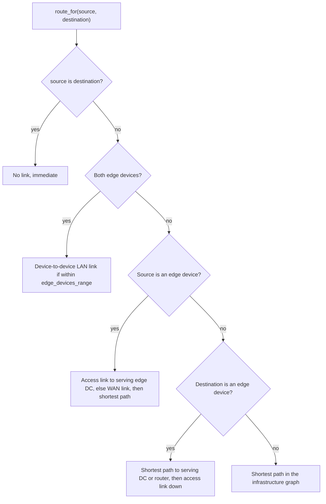

# Simulation models

The simulator replaces every physical subsystem with a small, deterministic model. This page documents the four that produce the reported numbers: energy, mobility, distributions, and network. Each is a set of plain Python classes you can read end to end.

## Energy model

`EnergyModelComputingNode` (`pureedgesim/nodes.py`) is a linear power model with a battery option. The fields are `idle_consumption`, `max_consumption`, `battery_powered`, `battery_capacity`, `initial_battery_level`, plus accumulated `cpu_energy_consumption` and `network_energy_consumption`.

CPU energy has two parts:

- **Static**: `add_static_energy(seconds)` adds `idle_consumption / 3600 * seconds`. It is charged every `update_interval` on each alive node, in `ComputingNode.update_status`.
- **Dynamic**: `add_dynamic_energy(task_length, total_mips)` adds `(max_consumption - idle_consumption) / 3600 * task_length / total_mips`, charged when a task starts execution.

Network energy is charged per transfer through `update_wireless_energy_consumption(size_in_bits, flag)` for edge devices, using the transmission or reception energy-per-bit set by `set_connectivity_type`. `get_total_energy_consumption()` returns `cpu_energy_consumption + network_energy_consumption`, all in Watt-hours.

Battery accounting: a battery node whose `battery_capacity - get_total_energy_consumption()` drops to zero or below dies at the next status tick (`update_status` sets `NodeStatus.DEAD` and `death_time`, and increments `dead_devices`). When a device type has `battery` true and an `initialBatteryLevel` of, say, 50, the topology generator seeds `cpu_energy_consumption` to `capacity * (1 - level/100)` so the fleet starts half charged.

Energy-per-bit defaults come from the parameters (see [Configuration](configuration.md)); Wi-Fi, cellular, and Ethernet each have their own transmission and reception figures.

## Probability distributions

Sixteen distribution classes live in `pureedgesim/distribution.py`, all subclassing `Distribution`. A distribution draws lazily from the shared `Randomness` stream, resolved per draw rather than at construction, so a distribution parsed before the seed is set still honors the seed at run time.

The abstract interface is `sample()` (a float draw), `mean()`, `min`/`max` properties, and `sample_int()` (floor of `sample()`). Discrete families set `is_discrete = True`.

Configure any numeric XML field with a distribution element:

```xml
<task_length distribution="lognormal" mean="25000" std="8000" min="5000"/>
```

Or from Python:

```python
from pureedgesim import NormalDistribution, ExponentialDistribution

length = NormalDistribution(25000, 8000).bounded(5000, float("inf"))
gap = ExponentialDistribution(3.0)
print(length.sample(), gap.mean())
```

| Name | Required options | Notes |
| --- | --- | --- |
| `constant` | `value` | Always returns `value`. |
| `uniform` | `min`, `max` | Needs `max >= min`; already bounded, ignores extra `min`/`max`. |
| `triangular` | `min`, `mode`, `max` | Needs `min <= mode <= max`. |
| `normal` | `mean`, `std` | Unbounded; pair with `min`/`max` to clamp. |
| `lognormal` | `mean`, `std` | `mean`/`std` are of the value, not of its logarithm. |
| `exponential` | `mean` | Mean > 0. |
| `erlang` | `shape`, `scale` | `shape` is a whole number >= 1; a `GammaDistribution` subclass. |
| `gamma` | `shape`, `scale` | Both > 0. |
| `weibull` | `shape`, `scale` | Both > 0. |
| `pareto` | `scale`, `shape` | Both > 0; `min == scale`; `mean` is infinite when `shape <= 1`. |
| `beta` | `alpha`, `beta` | Both > 0; support `[0, 1]`. |
| `bernoulli` | `probability` | Returns 1.0 or 0.0; discrete. |
| `binomial` | `trials`, `probability` | `trials >= 0`, `0 <= p <= 1`; discrete. |
| `geometric` | `probability` | Trials up to and including the first success, so support starts at 1; discrete. |
| `poisson` | `mean` | Mean > 0; uses a normal approximation for large means; discrete. |
| `categorical` | `values`, optional `weights` | Comma-separated; discrete when every value is a whole number. |

For any family except `uniform` and `triangular`, an optional `min`/`max` attribute wraps the draw in a `BoundedDistribution` (rejection sampling, clamped after 100 tries). A `ScaledDistribution` multiplies a draw by a factor; the XML parser uses it to convert the KB size fields into bits.

`DistributionFactory.create(name, options, rng)` builds a distribution from the attribute map; `distribution_from_element(element)` reads an XML element, treating a bare number as a `constant`.

## Mobility models

Locations are a frozen `Location(x_pos, y_pos)` dataclass. The base `MobilityModel` (`pureedgesim/mobility.py`) does not move on events. `generate_path()` precomputes the whole trajectory once, keyed by millisecond ticks, and `update_location(time)` reads it. A model only needs to implement `get_next_location(location)`.

The base class carries `speed`, `min/max_pause_duration`, `min/max_mobility_duration`, and a `parameters` dict of model options read from the `<mobility>` element's attributes (case-insensitive). Helpers: `get_parameter`, `get_parameter_int`, `get_parameter_bool`, `get_required_parameter`. The map is `[0, width] x [0, length]`; models either `reflect_location` (bounce) or `clamp_to_map`.

`MobilityModelFactory` maps names to classes:

| Name | Class | Behavior and options |
| --- | --- | --- |
| `random-waypoint`, `default` | `DefaultMobilityModel` | Random waypoint: moves for a mobility duration, pauses, re-orients; reflects at the borders. |
| `random-walk` | `RandomWalkMobilityModel` | Each step picks a random heading of length `speed * update_interval`. |
| `gauss-markov` | `GaussMarkovMobilityModel` | Correlated velocity. Options: `alpha` (0 to 1, default 0.7), `std` (direction noise, default 30), `speed_std` (default `0.2 * mean_speed`). |
| `manhattan` | `ManhattanMobilityModel` | Axis-aligned movement between grid intersections. Option: `grid_size` (default 100). |
| `waypoint` | `WaypointMobilityModel` | Follows a fixed list. Required option `waypoints="x1,y1;x2,y2;..."` (at least two points). Option `loop` (default true). |
| `circular` | `CircularMobilityModel` | Orbits a center. Options: `radius` (required, > 0), `center_x`, `center_y`, `clockwise` (default true). |
| `levy-walk` | `LevyWalkMobilityModel` | Heavy-tailed flight lengths (Pareto). Options: `min_step`, `max_step`, `shape` (default 1.5). |
| `brownian` | `BrownianMobilityModel` | Gaussian jitter each step. Option: `std` (default `speed * update_interval`). |
| `group`, `rpgm` | `ReferencePointGroupMobilityModel` | Points move with an offset from a randomly generated anchor path. Options: `group` (seed, default "1"), `anchor_speed`, `anchor_pause`. |

Two names alias to the same class (`random-waypoint`/`default`, and `group`/`rpgm`), which is why `pureedgesim models` lists eleven names for nine classes. You can also pass a dotted class path to the factory; it must resolve to a `MobilityModel` subclass.

A device with a `mobility_model` but no explicit `<mobility model>` (a plain `<mobility>true</mobility>`) uses `manager.default_mobility_model`, the class you can override with `Simulation.set_custom_mobility_model(SomeModelClass)`.

## Network model

`DefaultNetworkModel` (`pureedgesim/network.py`) routes, shares bandwidth, and charges link and device energy. Links are `NetworkLink` objects with `bandwidth` (bps), `delay` (s), `energy_per_bit` (Wh/bit), a `LinkType` (`WAN`, `MAN`, `LAN`), and a `LinkTechnology` (`WIFI`, `CELLULAR`, `ETHERNET`).

Bandwidth sharing is equal among concurrent transfers: `allocated_bandwidth()` is `bandwidth / len(transfers)`. On each `UPDATE_NETWORK` tick (every `network_update_interval`), a link advances every active transfer. In `realistic_network_model` mode it moves `elapsed * bandwidth` bits (gradual progress and contention); otherwise it completes the hop in one step.

Routing is latency-weighted Dijkstra on `InfrastructureGraph`, with paths cached per source/destination pair. Edge devices are never used as intermediate hops (only as endpoints), so mobility cannot open shortcuts. `route_for(source, destination)` handles four cases:



When a transfer finishes a hop, `_charge` books `elapsed_time` into `network_usage` (by link type) and `technology_usage`, records container traffic separately, adds the transferred bits to the link's energy (`transferred_bits * energy_per_bit` unless the link ignores energy), and charges the source (transmission) and destination (reception) energy when an endpoint is an edge device. The accumulated per-type and per-technology totals become the network-usage and network-energy columns; see [Output and metrics](output-and-metrics.md).

## Cross-links

- Energy, mobility, and network in the Java manual (identical formulas): [Java Simulation models](https://charafeddinemechalikh.github.io/PureEdgeSim/docs/models.html).
- How to replace a model with your own: the mobility hook in [Getting started](getting-started.md) and the network/customization gaps in [Python vs Java](python-vs-java.md).
