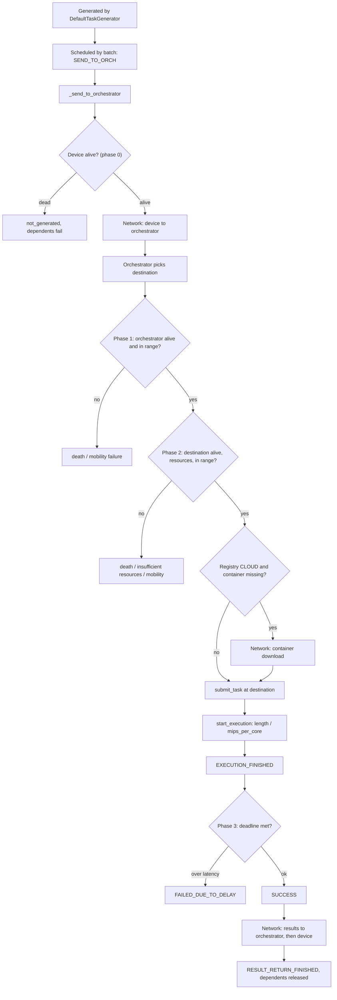
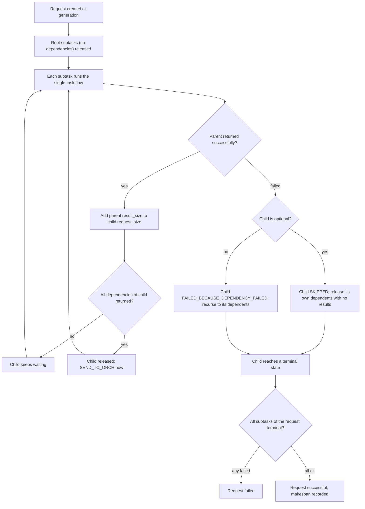

# Task lifecycle

This page traces one task from creation to result, then explains how a multi-subtask service-graph request is released and completed. All of it is driven by `SimulationManager` in `pureedgesim/manager.py` and `DefaultTaskGenerator` in `pureedgesim/tasks.py`.

## Generation is eager

The workload is generated in full before the first event runs. `start_simulation` calls `DefaultTaskGenerator.generate()`, which:

1. Picks the devices that generate tasks (`generates_tasks` and alive).
2. For each application, assigns devices by `usage_percentage` (the last application takes the remainder).
3. Emits tasks per minute. Without an `<arrival>` element, a burst of `rate` tasks is spaced evenly inside each minute; with an arrival distribution, gaps are drawn from it.
4. For a service-graph application, emits one task per subtask, wires `dependencies`/`dependents`, and stamps every subtask with the same `request_id`, `request_task_count`, `request_start_time`, and `request_deadline`.
5. Sorts all tasks by `time`.

The manager then splits the tasks: `root_tasks` are those with no `dependencies`. Only roots enter the queue at generation time; every other subtask waits for its parents to return.

## The single-task flow

### Step by step

- **`SEND_TO_ORCH`** calls `_send_to_orchestrator`. It registers the request, runs the phase-0 check (`task_failed(task, 0)`: if the source device is already dead, the task is counted as `not_generated` and its dependents fail). Then `_select_orchestrator` decides who decides. With `enable_orchestrators` false, that is the device itself (`task.get_orchestrator()`); otherwise it is chosen from `deploy_orchestrator` (`MIST`, `CLOUD`, `EDGE`, or the nearest node marked as an orchestrator). If the orchestrator is the device, the task goes straight to the destination-decision step; otherwise it is sent over the network to the orchestrator first.
- **`SEND_TASK_FROM_ORCH_TO_DESTINATION`** calls `_send_from_orchestrator_to_destination`. It runs the phase-1 check (orchestrator dead, or the orchestrator is a mist device now out of `edge_devices_range`), then finds the destination. If the device has `application_placed`, it reuses the cached `application_placement_location`; otherwise it calls `orchestrator.orchestrate(task, application_id)`. A `None` destination is a `NO_OFFLOADING_DESTINATIONS` failure. Then the phase-2 check runs (destination alive, `has_enough_resources`, and within range for a mist destination).
- **Container download.** When `enable_registry` is on and `registry_mode == "CLOUD"` and the destination is not a cloud node and does not already host the application, the container (`task.container_size`) is downloaded from the registry over the network first; afterwards the destination id is added to `installed_containers`.
- **`submit_task`** sets `arrival_time` and either starts the task (if a core and RAM are free) or appends it to `task_queue`. `start_execution` records `execution_start_time`, charges dynamic energy, computes `execution_duration = length / mips_per_core`, and schedules `EXECUTION_FINISHED`.
- **`EXECUTION_FINISHED`** frees the core and memory, records `execution_finish_time`, adds the instructions to `total_executed_instructions`, and calls `manager.on_task_execution_finished`. That increments the executed/execution-time/waiting-time counters and sends the result (`result_size`) back to the orchestrator, and from there to the source device.
- **`RESULT_RETURN_FINISHED`** calls `_results_returned`, which runs the phase-3 check and, if the task is still `RUNNING`, marks it `SUCCESS`, counts it, releases its dependents, closes the request, and finally gives the orchestrator a `results_returned` callback.

## The four failure checks

`task_failed(task, phase)` is called at each phase boundary. It returns true (and records the failure) if the task is already terminal.

| Phase | When | Checks | Status set |
| --- | --- | --- | --- |
| 0 | Before offloading | Source device not alive | `FAILED_DUE_TO_DEVICE_DEATH`, counted as `not_generated` |
| 1 | At the orchestrator | Orchestrator dead, or mist orchestrator out of `edge_devices_range` | `FAILED_DUE_TO_DEVICE_DEATH` / `FAILED_DUE_TO_DEVICE_MOBILITY` |
| 2 | Before submit | Destination missing/dead, insufficient RAM+storage, mist destination out of `edge_data_centers_range` | `FAILED_DUE_TO_DEVICE_DEATH` / `INSUFFICIENT_RESOURCES` / `FAILED_DUE_TO_DEVICE_MOBILITY` |
| 3 | Result returned | `total_delay >= max_latency`, or `request_deadline > 0 and clock >= request_deadline` | `FAILED_DUE_TO_DELAY` |

A phase-2 "no resources" or a `None` destination becomes `INSUFFICIENT_RESOURCES` / `NO_OFFLOADING_DESTINATIONS`, both counted under `not_executed`. `TaskStatus` values are `SUCCESS`, `RUNNING`, `FAILED_DUE_TO_DELAY`, `FAILED_DUE_TO_DEVICE_DEATH`, `FAILED_DUE_TO_DEVICE_MOBILITY`, `INSUFFICIENT_RESOURCES`, `NO_OFFLOADING_DESTINATIONS`, `NULL`, `FAILED_BECAUSE_DEPENDENCY_FAILED`, and `SKIPPED`.

The task's own `total_delay` is `total_network_time + waiting_time + actual_cpu_time`, exposed as a `Task.total_delay` property. The request deadline is separate: it is the application latency measured from `request_start_time`, so a subtask can meet its own bound and still fail because the request as a whole is late.

## Service-graph request flow

A request is a set of tasks sharing one `request_id`. Roots are released at generation; a non-root subtask is released only when every one of its dependencies has returned its results. When a parent returns, its `result_size` is added to each child's `request_size`, so the intermediate data actually crosses the network.

### How the release works

- `_results_returned` calls `_release_dependents(task)` on success. For each dependent that is not already terminal, it adds `task.result_size` to the child's `request_size`, then calls `child.dependency_finished()`. That method decrements `remaining_dependencies` and returns true once the last one has returned. When it returns true, the child's `time` is set to the current clock and a `SEND_TO_ORCH` event is scheduled for it.
- On failure, `_fail`/phase-0 call `_fail_dependents(task)`. For each non-terminal dependent: an optional child is skipped (`_skip_task` sets `SKIPPED`, increments `tasks_skipped`, and releases its own dependents without carrying results); a required child is marked `FAILED_BECAUSE_DEPENDENCY_FAILED`, increments `dependency_failures`, and the failure propagates down its subtree.

### Request accounting

Each request is a `_RequestRecord` created on first sight of one of its tasks, which increments `generated_requests`. `_request_task_finished` decrements the record's `remaining` counter on every terminal subtask. When `remaining` reaches zero, the request is counted as successful (and its makespan, `clock - start_time`, accumulated) unless any subtask flagged it failed, in which case it counts as a failed request. These feed the `Requests generated`, `Successful requests`, and `Average request makespan` columns; see [Output and metrics](output-and-metrics.md).

## Termination

A `PRINT_LOG` event is scheduled at `simulation_duration`. `_check_termination` counts tasks that are neither finished nor already failed. If `wait_for_all_tasks` is true and tasks remain pending while the clock is below `simulation_duration + 3600` seconds, it reschedules itself ten seconds later; otherwise it calls `engine.terminate()`. So `wait_for_all_tasks` extends the run to drain the queue, bounded by one extra simulated hour.

## Cross-links

- The Java lifecycle (same event tags and failure phases): [Java Task lifecycle](https://charafeddinemechalikh.github.io/PureEdgeSim/docs/task-lifecycle.html).
- Writing the placement policy that fills in the `orchestrate` step: [Writing orchestrators](orchestrators.md).
