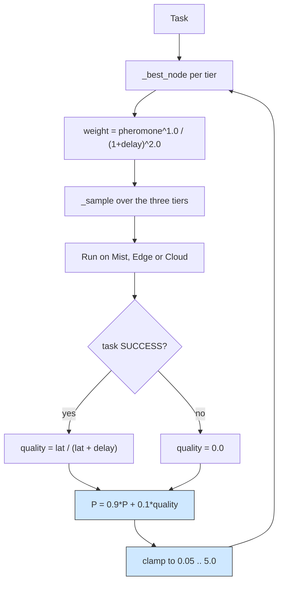

# Ant colony: a pheromone trail per tier, sampled against a delay heuristic

## What it shows

Which tier earns the load is not fixed, it is negotiated by the traffic itself.
`AntColonyOrchestrator` keeps one pheromone trail per tier (`Mist`, `Edge`,
`Cloud`), seeded at `INITIAL_PHEROMONE` = 0.5. In `find_computing_node` a tier is
sampled with a weight that multiplies the trail by a delay heuristic,
`weight = pheromone ** ALPHA / (1 + delay) ** BETA` with `ALPHA` = 1.0 and
`BETA` = 2.0, so a fast tier is preferred from the first task while the trail
still adapts. In `results_returned` the trail of the tier that ran the task is
updated as `(1 - EVAPORATION) * P + EVAPORATION * quality` with `EVAPORATION` =
0.1, where `quality` is `max_latency / (max_latency + total_delay)` for a
success and 0 for a failure, and the result is clamped between `MIN_PHEROMONE` =
0.05 and `MAX_PHEROMONE` = 5.0. Those bounds are the point: a failed tier never
drops to zero, so it stays a candidate, and a lucky tier never saturates, so one
early win cannot lock the choice. Inside the chosen tier the node with the
smallest estimated delay, counting the tasks already pending on it, executes the
task.



## The scenario

`settings/` runs one scenario, once, on a fixed seed:

- 300 devices on a 2000 by 2000 meters map, with a 20 meters device-to-device
  (mist) range, on the `ALL` architecture and the `ANT_COLONY` algorithm,
  `random_seed` = 29, five simulated minutes, decisions made on the device
  (`enable_orchestrators` = false);
- a fleet of five device types, two of which are sensors with no computing
  power (0 cores), so only about 40% of the devices can host a mist task;
- four edge data centers of 10 cores at 40000 MIPS, one cloud of 200 cores, and a
  shared 20 Mbps WAN uplink with a 0.06 s latency;
- three applications: Health (Hard Real-time, 20%, 500 MI, 0.02 s bound),
  Augmented reality (Soft Real-time, 30%, 5000 MI, 0.5 s bound) and
  HEAVY_COMP_APP (Non Real-time, 50%, 30000 MI, 300 s bound).

## Run it

From the repository root, after `pip install -e .`:

```bash
python examples/ant_colony/ant_colony.py
```

No-install variant:

```bash
PYTHONPATH=src python examples/ant_colony/ant_colony.py
```

## What to look for

```text
ANT_COLONY  devices= 300 tasks= 16870 ok= 3855 avg_delay=0.1776 cloud=4098 edge=9313 mist=3459 energy=78.273
```

- The average delay of completed tasks, 0.1776 s, is the second best of the four
  policies measured on this five minute scenario, behind the softmax run at
  0.1756 s and ahead of the multi-objective agent (0.1835) and the priority rule
  (0.1859), because the inverse-delay term in the sampling weight already pushes
  early tasks toward the fastest tier before the trail has learned much.
- The per-tier success rates are the counter-intuitive part. The colony sent the
  most tasks to the edge (9313) yet only 720 of them met their latency budget
  (7.7%): the 30000 MI HEAVY jobs pile onto the MEC hosts (edge CPU usage 9.94%,
  the highest tier) and then miss their bound. The mist carried only 3459 tasks
  but returned 2445 successes (70.7%), so the trail correctly ranks mist first
  even though the raw counts rank edge first.
- The cloud, the slowest tier on the shared WAN, got 4098 placements and 690
  successes, and its pheromone stays at the `MIN_PHEROMONE` = 0.05 floor instead
  of being cut off, which is exactly why it still receives a few exploratory
  tasks.
- Total energy is 78.27 Wh and sits in the edge (37.21 Wh) and the mobile fleet
  (mist 34.24 Wh), not in cloud compute (6.82 Wh). Results go to
  `examples/ant_colony/output/`.

Tune `ALPHA` up to trust the trail more and the heuristic less, or raise
`EVAPORATION` to make the colony forget old outcomes faster.

## Files

- `ant_colony.py` with `AntColonyOrchestrator`
- `settings/` with `simulation_parameters.properties`, `applications.xml`,
  `edge_devices.xml`, `edge_datacenters.xml` and `cloud.xml`

## Where to go next

- [Q-learning](../q_learning/README.md) for a value table instead of a trail, on
  the same three applications
- [Softmax orchestrator](../softmax_orchestrator/README.md) for another sampled
  policy, drawing the tier from a Boltzmann distribution
- [Writing orchestrators](../../docs/orchestrators.md) for the `find_computing_node`
  and `results_returned` hooks this policy uses
- [Output and metrics](../../docs/output-and-metrics.md) for the 56 CSV columns
