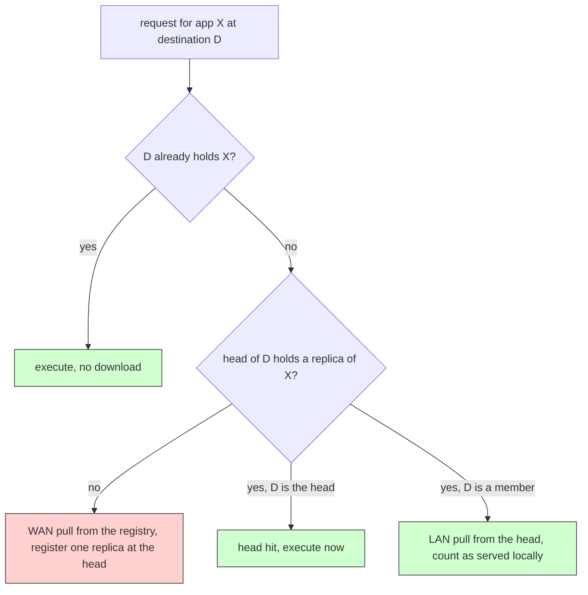

# Clustering and cooperative caching: two extension points at once

## What it shows

How to combine two of PureEdgeSim's extension points so that containers reach the
edge devices without always crossing the WAN. This is the Python port of the Java
`Example7`, the cooperative caching of Mechalikh, Taktak and Moussa (HPCS 2019),
and it is the reason those two hooks were added to the runner.

Read the Java example first. It installs two classes: `Example7ClusteringDevice`
that turns the flat device list into a tree with elected heads, and
`Example7CustomNetworkModel` that overrides `transferFinished`, and when a task
arrives pulls the container from a nearby replica instead of the cloud registry.
The Python port reaches the same two extension points with `set_custom_topology_creator`
and `set_custom_network_model`. Open `clustering_and_caching.py` and look at
`ClusterTopologyCreator` (extends `DefaultTopologyCreator`) and
`CooperativeCacheNetworkModel` (extends `DefaultNetworkModel`).

The topology creator does the clustering: each device is scored on capacity, battery,
stability and neighbourhood, points to the best reachable neighbour within
`edge_devices_range`, and the devices that point to themselves become the heads.
Every member gains a direct LAN link to its head, and every head is added to
`nodes_generator.orchestrators`, so `deploy_orchestrator=CLUSTER` places the
orchestrator on a head instead of on the cloud. The network model does the caching:
the Python core emits a `send(task, ..., "container download")` transfer only when a
destination has to fetch a container, so the cooperative cache intercepts that
transfer. A cold application still crosses the WAN to the registry, the first pull
registers a replica on the destination's head, and later requests of the same
application inside that cluster are routed from the head over the LAN instead. The
synergy the example is built to show is that a replica is only worth caching at the
head when the tasks that need it stay in the cluster.

One note on `registry_mode`. The shipped settings mirror the Java file and keep
`CACHE`, which in the Python core means "the container is already installed and
free". For the cooperative cache to observe a real download to intercept, the
script pins `registry_mode` to `CLOUD` on every run. That is the "pull from the
remote registry" path the HPCS paper measures against, and it is exactly the
behaviour the Java custom network model overrides.



## The scenario

The files in `settings/` mirror the Java Example7 scenario, a small 100 by 100 map
with 300 devices, `edge_devices_range=20` so every device has close neighbours but
not the whole map, `enable_registry=true`, `registry_mode=CACHE`,
`enable_orchestrators=true`, `deploy_orchestrator=CLUSTER`, the `MIST_ONLY`
architecture (only mist devices execute tasks) and `ROUND_ROBIN` placement (kept
simple so the caching effect is not confounded by a load-balancing heuristic), and
60 simulated minutes. The script pins `registry_mode` to `CLOUD` so the cooperative
cache can see the downloads to intercept, and it writes both a cooperative row and
a registry-only baseline into a single `Sequential_simulation.csv`, so the two
scenarios can be compared directly.

## Run it

From the repository root, after `pip install -e .`:

```bash
python examples/clustering_and_caching/clustering_and_caching.py
```

The same script runs without installing the package, as long as `src` is on the path:

```bash
PYTHONPATH=src python examples/clustering_and_caching/clustering_and_caching.py
```

An optional device count, duration and seed shrink the run:

```bash
python examples/clustering_and_caching/clustering_and_caching.py 30 180 11
```

## What to look for

The full scenario prints a clustering report, a cooperative-cache report and two
rows, the cached one and the registry baseline:

```text
Clustering - 9 cluster heads over 300 devices, 582 tree links wired, average size 33.3, largest 76
CooperativeCache - cooperative cache: 26 WAN pulls, 679 cluster pulls (96.3 % served locally), 22 head hits, 26 distinct replicas over 9 heads
CACHE cluster      tasks= 182700 ok=   9180 wan_usage=4.8533      container_wan=4.8533     container_lan=40.7008   traffic_MB=168571.39 avg_delay=0.1445   energy=419.7236
CLOUD cluster      tasks= 182700 ok=   9180 wan_usage=314.544     container_wan=314.544    container_lan=0.0       traffic_MB=168841.13 avg_delay=0.1445   energy=419.5126
saving - WAN usage: 309.6907 s avoided out of 314.5440 s in the registry run
```

The same numbers read back from the CSV (`Wan usage (s)`, `Containers wan usage (s)`,
`Containers lan usage (s)`, `Total network traffic (MBytes)` and
`WAN energy consumption (Wh)`) are:

| Row | Wan usage | Containers wan | Containers lan | Traffic (MB) | WAN energy (Wh) |
| --- | --- | --- | --- | --- | --- |
| CACHE cluster (cooperative) | 4.8533 s | 4.8533 s | 40.7008 s | 168571.39 | 0.0065 |
| CLOUD cluster (registry) | 314.5440 s | 314.5440 s | 0.0000 s | 168841.13 | 0.1525 |

- What the clustering changed in the placement. The 300 devices collapse into 9
  heads with 582 tree links, the largest cluster holding 76 devices and the average
  holding 33.3. Because `deploy_orchestrator=CLUSTER` now finds a real head in
  `nodes_generator.orchestrators`, `_select_orchestrator` returns the cluster head
  instead of the cloud registry. In MIST_ONLY every task still lands on a mist node
  (`Total tasks executed (Mist) = 87584`, `Total tasks executed (Cloud) = 0` on both
  rows) so clustering does not move the tasks themselves. It moves the control
  traffic: in the cached row, `Wan usage` equals `Containers wan usage` (both
  4.8533 s), which means the WAN carries container traffic and nothing else. Every
  request and every result returned to the source device stays inside the cluster,
  over the LAN, on the 582 tree links the topology creator wired.
- What caching saved. 679 of 705 container downloads (96.3 %) were served locally
  and 22 more were free because the destination was the head and already held the
  replica; 26 were cold applications that had to cross the WAN, one per
  application per cluster, which is exactly what a cooperative cache should cost.
  The registry baseline pays 314.5440 s of WAN for those same 705 downloads, so
  the cooperative cache removes 309.6907 s (98.46 %) of WAN time and shifts 40.7008 s
  of that traffic to the LAN. The WAN energy column tracks it: 0.1525 Wh in the
  registry run versus 0.0065 Wh in the cooperative one, the same 23.5-times
  reduction the paper argues for.
- What did not change, and why that matters. `Average execution delay` (0.1445 s),
  `Tasks successfully executed` (9180) and `Tasks failed (delay)` (78404) are the
  same on both rows. In this scenario only about 5 % of tasks clear their tight
  `max_latency`, and the container download sits in the shadow of the queue and the
  execution, so the caching effect is measured in the WAN columns, not in the
  success or the delay. A cache that "made no task faster" but cut the WAN bill by
  98 % is the outcome the HPCS paper reports, and the one this example reproduces.
- A smaller run makes the same effect visible in a second:
  `python examples/clustering_and_caching/clustering_and_caching.py 30 180 11`
  clusters 30 devices into 13 heads, gives 14 cluster pulls against 19 WAN pulls,
  moves container_wan from 3.6309 s to 1.5893 s, and turns the failure rate around
  because at that scale the container download does sit on the task's critical
  path.

## Files

- `clustering_and_caching.py` with `ClusterTopologyCreator`, `CooperativeCacheNetworkModel`,
  the pure `elect_heads` and `cluster_score` helpers, `build` and `main`
- `settings/` with the 300-device, 60-minute MIST_ONLY and CLUSTER scenario

## Where to go next

- [Extension points](../extension_points/README.md) for the same
  `set_custom_topology_creator` and `set_custom_network_model` used as pure observers
  in a tour of all eight setters
- [Self clustering](../self_clustering/README.md) for the same head election seen
  from the orchestrator side, with cluster-local placement instead of caching
- [Container cache](../container_cache/README.md) for a bounded LRU cache without
  the cluster sharing layer, so you can see exactly which half of the savings the
  cluster is buying
