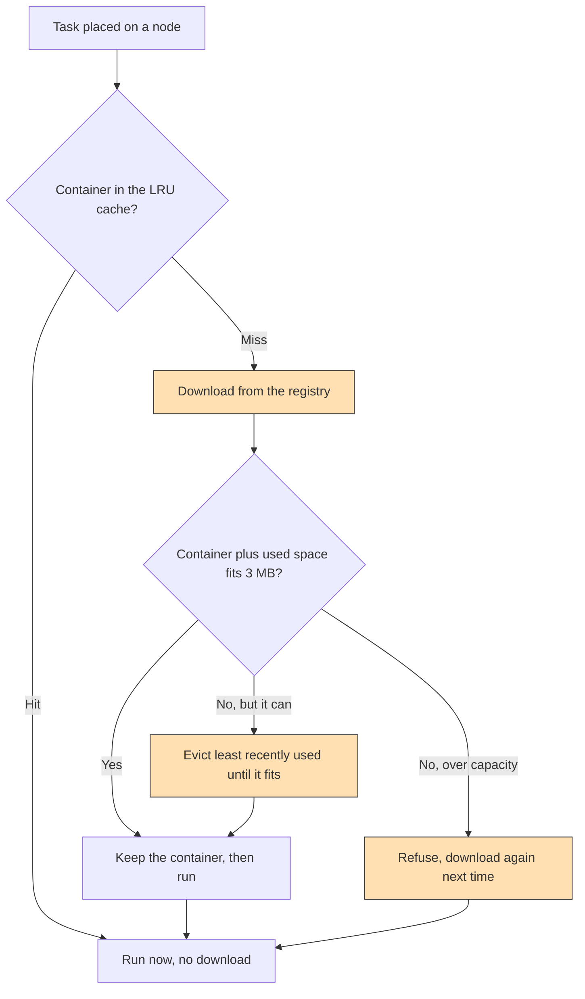

# Container caching: keeping the image where the task runs

## What it shows

An edge node that runs an application needs that application's container
installed first, and pulling it over the network is expensive. `CACHE` mode
answers this with a small storage-aware cache: every node reserves a few
megabytes of its storage for containers, a request whose container is already
there runs without a download, and a request whose container is missing fetches
it once and keeps it for the next request. When the budget is full the least
recently used container is evicted.

The Python core has no hook for a custom network model or a custom computing
node, so the behaviour lives in `ContainerCacheSimulationManager`, a subclass of
`SimulationManager`. On a placement it calls `_needs_container`, which consults
the destination cache: a hit returns false and skips the transfer, a miss
remembers the container in `pending_store`. When the download has finished,
`_send_request_to_destination` stores it, evicting the oldest entries until the
new one fits, or refusing it if it is larger than the whole cache. A plain
`dict` keeps the access order, and a lookup moves the container to the end, so
the first key is always the least recently used one.

The point of the example is that the bounded cache is a middle ground, so the
script runs the same workload three times on the same seed, differing by one
flag:

- `cache`, the LRU cache described above;
- `cloud_always`, `UncachedRegistryManager` with `registry_mode=CLOUD`, which
  downloads a container for every single request, the honest baseline;
- `cloud`, the plain `SimulationManager`, which remembers every downloaded
  container forever, an unbounded cache nobody would pay for in production.



## The scenario

`settings/` sets up one scenario:

- 300 devices on a 2000 by 2000 meters map, a 20 meters device-to-device range,
  seed 61, five simulated minutes;
- four peripheral edge data centers, each 10 cores at 40000 MIPS and 200000 MB
  of storage, linked in a ring over the MAN;
- the `EDGE_ONLY` architecture, so every offloaded task runs on the edge and the
  cloud is never a destination;
- a cloud orchestrator (`deploy_orchestrator=CLOUD`), so each request crosses
  the 20 Mbps WAN to the cloud and back even though the cloud computes nothing;
- the registry enabled in `CACHE` mode, and the three default applications whose
  containers weigh 0.02 MB (Health, Hard Real-time, 20 ms), 1.5 MB (Augmented
  reality, Soft Real-time, 0.5 s) and 2.2 MB (HEAVY_COMP_APP, Non Real-time).

`CACHE_CAPACITY_MB` is 3.0, so a node can hold the two heavy containers
together but not all three, which forces real evictions. A node never reserves
more than its own storage, and a sensor has no storage, so only the four data
centers and the 120 battery or mains devices get a cache.

## Run it

From the repository root, after `pip install -e .`:

```bash
python examples/container_cache/container_cache.py
```

No-install variant:

```bash
PYTHONPATH=src python examples/container_cache/container_cache.py
```

## What to look for

The cached run opens with the cache report:

```text
ContainerCache - container cache: 10334 hits, 6536 misses (61.26 % hit ratio), 804 evictions, 0 refused, 8.14 MB used of 372.00 MB
cache         tasks= 16870 ok=  1770 success=10.49 % avg_delay=0.1599   wan_usage=488442.252   containers_lan=4153.4043 traffic_MB=51042.06   energy=77.5232
cloud_always  tasks= 16870 ok=  1770 success=10.49 % avg_delay=0.1599   wan_usage=488143.868   containers_lan=13620.5818 traffic_MB=62212.0    energy=77.5232
cloud         tasks= 16870 ok=  1770 success=10.49 % avg_delay=0.1599   wan_usage=488116.732   containers_lan=15.9179  traffic_MB=42542.22   energy=77.5232
```

All three rows carry the same workload, so the only columns that move are the
container traffic and the request makespan.

| Container handling | Total traffic (MB) | Container LAN time (s) | Request makespan (s) |
| --- | --- | --- | --- |
| LRU cache (`cache`) | 51042.06 | 4153.4043 | 5.9429 |
| Download every request (`cloud_always`) | 62212.00 | 13620.5818 | 6.6051 |
| Never evict (`cloud`) | 42542.22 | 15.9179 | 4.9429 |

- The cache turns 10334 of the 16870 requests into a hit, a 61.26 percent hit
  ratio, and evicts 804 containers to stay inside the 3 MB budget. The 372 MB
  total capacity is 124 nodes times 3 MB, so nothing is refused (0 refused): the
  largest container, 2.2 MB, always fits on its own.
- Against the download-every-request baseline the cache removes 17.95 percent of
  the traffic (62212.0 down to 51042.06 MB) and 69.5 percent of the container
  transfer time (13620.5818 down to 4153.4043 s). The never-evict baseline shows
  the ceiling, 42542.22 MB, so the bounded cache captures most but not all of
  the savings.
- The honest cost: in this port the container download is charged to the request
  makespan and the traffic, not to the task compute latency. So the three rows
  report the identical average execution delay of 0.1599 s, the same 1770
  successes out of 16870 (10.49 percent), and the same 77.5232 Wh. The cache
  buys network volume and a faster request (makespan 6.6051 down to 5.9429, 10
  percent), not a higher success rate.
- The low 10.49 percent success is the scenario, not the cache: a cloud
  orchestrator sends every hard real-time Health task over the 20 Mbps WAN
  twice, which blows its 20 ms budget regardless of how the container is
  handled. The WAN column (about 488000 s, mostly those orchestrator round
  trips) barely moves across the three runs, confirming that container
  downloads here travel over the MAN between the data centers.

Lower `CACHE_CAPACITY_MB` toward 1.5 to make the heavy 2.2 MB container
refusable, or raise it above 3.7 to let every node hold all three and watch the
evictions drop to zero.

Results go to `examples/container_cache/output/`.

## Files

- `container_cache.py` with `ContainerCache`, the cached manager, the uncached
  baseline and the three-way `main`
- `settings/` with `simulation_parameters.properties`, `applications.xml`,
  `edge_devices.xml`, `edge_datacenters.xml` and `cloud.xml`

## Where to go next

- [Clustering and caching](../clustering_and_caching/README.md) for a policy
  that both clusters devices and caches their containers
- [Fog layers](../fog_layers/README.md) for a placement that fills the mist
  before overflowing to the edge
