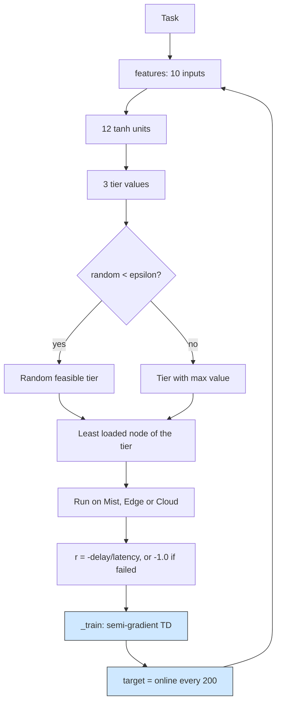

# Context-aware DRL: a small neural network values each tier from the device context

## What it shows

This answers what a table cannot: what to do in a context the agent has never
seen. `ContextAwareOrchestrator` replaces the Q-table with a two-layer network
(`HIDDEN_UNITS` = 12 over `FEATURE_COUNT` = 10 inputs) whose inputs describe the
device and the task: an application one-hot (3), the task length scaled by
`LENGTH_SCALE` = 100000, the battery level, a cellular flag, a mobility flag and
the load of each of the three tiers. Because nearby contexts share the same
weights, a low-battery cellular phone produces a sensible value even if that
exact combination never appeared before. Training is online semi-gradient
temporal-difference in `_train`: the target is `reward + 0.9 * max Q_target(next)`
(`DISCOUNT_RATE` = 0.9), the weights move by `LEARNING_RATE` = 0.02, and the
target network is refreshed every `TARGET_SYNC` = 200 updates. The reward is
`-total_delay / max_latency` for a success and `FAILURE_PENALTY` = -1.0 for a
failure. Exploration starts at `EPSILON_START` = 0.3 and decays by
`EPSILON_DECAY` = 0.999 per decision down to `EPSILON_END` = 0.02. The network is
built from plain Python lists, so the example keeps the dependency-free promise of
the package.



## The scenario

`settings/` runs one scenario, once, on a fixed seed, for twice as long as the
other adaptive examples:

- 300 devices on a 2000 by 2000 meters map, `ALL` architecture and the
  `CONTEXT_AWARE` algorithm, `random_seed` = 17, ten simulated minutes,
  decisions made on the device (`enable_orchestrators` = false);
- a multi-access fleet of three task-generating types: smartphones on cellular
  (40%, mobile, battery powered), tablets on Wi-Fi (30%, battery) and mains
  laptops on Wi-Fi (30%); every type has 8 cores, so the mist is well equipped;
- four edge data centers of 16 cores at 60000 MIPS (stronger than the other
  examples) within a 1200 meters coverage, a cloud of 200 cores, and the shared
  20 Mbps WAN at 0.06 s latency;
- the same three applications: Health (Hard Real-time, 500 MI, 0.02 s),
  Augmented reality (Soft Real-time, 5000 MI, 0.5 s) and HEAVY_COMP_APP (Non
  Real-time, 30000 MI, 300 s).

## Run it

From the repository root, after `pip install -e .`:

```bash
python examples/contextaware_drl/contextaware_drl.py
```

No-install variant:

```bash
PYTHONPATH=src python examples/contextaware_drl/contextaware_drl.py
```

This run is the slowest of the four (a 10-minute scenario with a forward pass per
task), so give it a few minutes.

## What to look for

```text
CONTEXT_AWARE            devices= 300 tasks= 43500 ok= 37637 avg_delay=0.1531   cloud= 7164 edge=33629 mist= 2707 energy=197.7162
```

- The network now loads the edge almost entirely (33629 edge, against 7164 cloud
  and 2707 mist) instead of spreading across the three tiers. The strong edge data
  centers (16 cores at 60000 MIPS) dominate every context the value function
  sees, so once a tier wins early it keeps winning, and the slow epsilon decay
  (0.999 per decision) is no longer enough to pull the policy back to the others.
- Success is won in the edge, with 31848 of 33629 tasks clearing their budget
  (94.7%), versus 2069 of 2707 in the mist (76.4%) and 3720 of 7164 in the cloud
  (51.9%), so the value function ranks the edge highest once the context is fed
  through the network.
- The headline average delay, 0.1531 s, is now below the five-minute policies on
  the ant colony topology (the ant colony itself is 0.1666), but the honest reason
  is the scenario, not the policy: this run uses the stronger 60000 MIPS edge, so
  with the corrected transfer model most edge jobs finish fast. The run is still
  twice as long, and 40% of the devices reach the network over the slower cellular
  link, so its energy and traffic are far larger than the five-minute runs: LTE
  transfer energy alone is 468.79 Wh, the computing-node total is 197.72 Wh, and
  network usage is 5522.77 s against the 767.19 s of the ant colony run. Do not
  read 0.1531 as "better than the others"; it is not a like-for-like comparison.
- Results go to `examples/contextaware_drl/output/`.

Raise `EPSILON_DECAY` toward 1.0 (slower decay) to keep exploring, or lower it to
let the network commit sooner.

## Files

- `contextaware_drl.py` with `ContextAwareOrchestrator`
- `settings/` with `simulation_parameters.properties`, `applications.xml`,
  `edge_devices.xml`, `edge_datacenters.xml` and `cloud.xml`

## Where to go next

- [Q-learning](../q_learning/README.md) for the bucketed table this network
  replaces
- [Multi-objective](../multi_objective/README.md) for two scalar tables that add
  an energy objective
- [Models](../../docs/models.md) for the mobility and connectivity models the
  context features read
- [Output and metrics](../../docs/output-and-metrics.md) for the energy and
  network-usage columns
