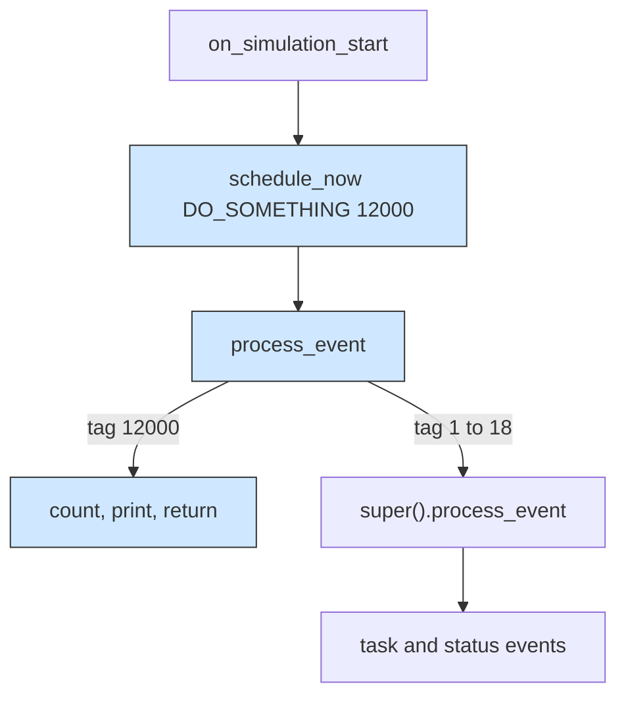

# Custom computing node: a node that handles an event of its own

## What it shows

Other examples replace a policy or a model, but this one reaches the node itself,
the object that every layer is built from. The class registered with
`set_custom_computing_node` constructs the cloud data center, the edge data center,
and every edge device alike, so a single subclass adds behaviour to the whole
fleet. Open `ReportingNode`.

`ReportingNode` extends `ComputingNode` and adds exactly one thing: in
`on_simulation_start` it calls `schedule_now(self, DO_SOMETHING)` to send an event
to itself. In `process_event` it intercepts that event, counts it, prints, and
returns, and forwards everything else to `super().process_event`. The private tag
`DO_SOMETHING = 12000` is the crux: the framework's own tags are `EventType`
members numbered 1 to 18 (`EXECUTE_TASK` is 3, `UPDATE_STATUS` is 15,
`DOWNLOAD_CONTAINER` is 18), so any other integer is free, and it must not collide,
because reusing a tag inside 1 to 18 would silently swallow a real task or status
event. The `type` setter is there so all three layers still report their own
`NodeType` and derive `is_peripheral`, which the mobile devices need to find their
data centers.



## The scenario

The settings folder carries the seven architecture by two algorithm sweep of the
Java defaults, and the script overrides it to one short run: 20 devices on a 200 by
200 map, one cloud data center, one edge data center (dc1 at 100,100), the `ALL`
architecture, the `TRADE_OFF` algorithm, `random_seed=7`, and 300 simulated
seconds. That is 1 cloud node, 1 edge node, and 20 device nodes, 22 nodes in total,
each of which receives the custom event once.

## Run it

From the repository root, after `pip install -e .`:

```bash
python examples/custom_computing_node/custom_computing_node.py
```

The same script runs without installing the package, as long as `src` is on the
path:

```bash
PYTHONPATH=src python examples/custom_computing_node/custom_computing_node.py
```

An optional device count and output folder shrink the run.

## What to look for

```text
22 nodes received the custom event: cloud=1, edge_datacenter=1, edge_device=20
custom_computing_node      tasks= 1035 ok=  285 avg_delay=0.1994   energy=11.6627  cpu=0.5838%
```

- The 22 printed "Event received by" lines, one per node, and the counter split
  `cloud=1, edge_datacenter=1, edge_device=20`, show that the one registered class
  really built the entire fleet and that every node ran its own event exactly once.
- Energy 11.6627 Wh and average CPU 0.5838% are the proof, not decoration. Every
  event the node does not own is forwarded to `super().process_event`, so the
  built-in energy accounting and the `UPDATE_STATUS` tick keep running. Drop that
  forwarding line and the status events stop, which silently corrupts these two
  columns, so the unchanged energy is what confirms the subclass stayed honest.
- The 0.1994 s average delay and 285 of 1035 tasks succeeding (27.5%) match the
  stock scenario exactly, which is the intended result: the custom event is a
  one-off that neither helped nor hurt the offloading, and the low success rate
  belongs to the short 5 minute run, not to the subclass.

## Files

- `custom_computing_node.py` with `ReportingNode` and the private `DO_SOMETHING` tag
- `settings/` with the 20-device, one-edge, one-cloud scenario

## Where to go next

- [Extension points](../extension_points/README.md) for the same
  `set_custom_computing_node` hook used as a pure observer in a tour of all eight
  setters
- [Custom orchestrator](../custom_orchestrator/README.md) for changing a decision
  instead of a node, which is the other half of the wiring API
