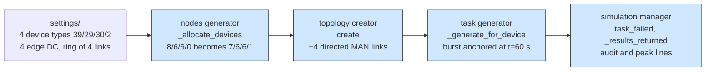

# Custom models: replacing the four models that build a scenario

## What it shows

Every other example leaves at least part of the scenario to the default models and
registers only what it wants to teach, usually the orchestrator or the mobility
model. This one registers the four models that assemble a run before the first
event fires, and uses each of them to actually change the scenario, so the two
result rows differ everywhere except the workload size:

| Model | Setter on `Simulation` | Custom class | What it changes |
| --- | --- | --- | --- |
| Computing nodes generator | `set_custom_computing_nodes_generator` | `TypeGuaranteeGenerator` | reserves a device for the type the default split rounds to zero |
| Topology creator | `set_custom_topology_creator` | `FullMeshTopologyCreator` | completes the declared ring of edge data centers into a full mesh |
| Task generator | `set_custom_task_generator` | `BurstTaskGenerator` | lands the whole fleet's first-minute burst on one instant |
| Simulation manager | `set_custom_simulation_manager` | `AuditSimulationManager` | audits every task by outcome and prints the arrival peak |

Each class extends its default, overrides one method, and delegates everything else
to `super`, the same shape as the four `setCustom...` classes of the Java example.
The script launches the identical scenario twice, once with the stock models and
once with these four, then prints the two rows side by side.

The four hooks follow the order the framework uses to build a scenario: nodes, then
links, then workload, then the event loop.



## The scenario

`settings/` holds one small scenario, run twice on the same seed so the only
difference is the four models:

- 20 devices on a 2000 by 2000 meters map, four types at 39, 29, 30 and 2 percent
  (smartphone on cellular, tablet and laptop on Wi-Fi, and a 2-core wearable on
  Wi-Fi), `edge_devices_range` = 20 m;
- four edge data centers that declare a ring of backbone links (1000 Mbps, 0.01 s
  per MAN hop) plus one cloud behind a 20 Mbps WAN (0.06 s), with a 1200 m
  data-center coverage;
- the `ALL` architecture and the built-in `TRADE_OFF` policy,
  `enable_orchestrators` = false (each device decides for itself);
- three applications: Health (20 per minute, 20 percent of the fleet, 0.02 s
  bound, 500 MI), Augmented reality (30 per minute, 30 percent, 0.5 s, 5000 MI)
  and HEAVY_COMP_APP (3 per minute, 50 percent, 300 s, 30000 MI);
- five simulated minutes, `random_seed` = 83, no container registry.

## Run it

From the repository root, after `pip install -e .`:

```bash
python examples/custom_models/custom_models.py
```

No-install variant:

```bash
PYTHONPATH=src python examples/custom_models/custom_models.py
```

Optional arguments shrink the run for a quick look: a device count, then the output
folder.

```bash
PYTHONPATH=src python examples/custom_models/custom_models.py 6 /tmp/custom_models
```

## What to look for

The custom launch prints the four hooks firing:

```text
TypeGuaranteeGenerator - Device type 4 declares 2.0 % of the fleet, a share that rounds to zero: one device reserved from type 1
FullMeshTopologyCreator - Added 4 directed MAN links to complete the full mesh of 4 edge data centers
AuditSimulationManager - audit: 446 succeeded, 1004 failed, 0 not sent (FAILED_DUE_TO_DELAY 1004)
AuditSimulationManager - link usage: WAN 169.34 s, MAN 0.00 s, LAN 42.13 s, 0 transfers crossed a MAN link
AuditSimulationManager - busiest instant: 20 tasks arrive together at t=60 s over 1450 generated tasks
```

Both rows below are the `ALL / TRADE_OFF / 20 devices` scenario at five simulated
minutes and seed 83, read from the two CSVs that one run of the script writes.

| Metric | Stock models | Custom models |
| --- | --- | --- |
| Device split over the four types | 8, 6, 6, 0 | 7, 6, 6, 1 |
| Directed MAN links in the graph | 8 | 12 |
| Number of generated tasks | 1450 | 1450 |
| Tasks successfully executed | 452 (31.17 %) | 446 (30.76 %) |
| Failed due to latency | 998 | 1004 |
| Placed on cloud, edge, mist | 189, 633, 628 | 165, 691, 594 |
| Succeeded on edge, on mist | 53, 399 | 15, 431 |
| Average execution delay (s) | 0.3877 | 0.4484 |
| Average request makespan (s) | 1.0574 | 1.212 |
| Network usage, WAN, LAN (s) | 229.30, 206.49, 22.81 | 211.47, 169.34, 42.13 |
| Average bandwidth per task (Mbps) | 509.1592 | 334.476 |
| MAN energy consumption (Wh) | 0.0 | 0.0 |
| Energy of computing nodes (Wh) | 38.7005 | 37.5392 |
| Average CPU usage (%) | 0.8093 | 0.9901 |
| Dead devices, device-death, mobility failures | 0, 0, 0 | 0, 0, 0 |

- The reservation is exactly what it claims. The largest remainder method gives the
  2 percent type `20 * 2 / 100 = 0.4` of a device, so the stock fleet is 8, 6, 6 and
  no wearable at all; the custom generator takes one slot from the type with the
  most (type 1, which drops from 8 to 7) and prints the new split. The fleet still
  has 20 devices, and the 2-core wearable is present in the custom run and absent in
  the stock one.
- The full mesh is real but unused by this policy. The topology file declares four
  links, the default creator wires them in both directions (8 directed MAN links),
  and a mesh of four data centers needs 12, so the four missing directions are what
  the script prints. Two opposite data centers go from 2 hops and 0.02 s to 1 hop and
  0.01 s on the graph. Yet `MAN energy consumption (Wh)` is 0 in both rows and
  `0 transfers crossed a MAN link`: with `enable_orchestrators` = false and the
  `TRADE_OFF` rule, every task is served by the node closest to its device, so no
  route ever hands work from one data center to another. The mesh buys a shorter path
  and a redundant route that a tier-hopping policy would use, not this one.
- Synchronizing the fleet is a cost, not a win. The workload size is unchanged (1450
  tasks in both rows), but the custom burst puts the whole fleet of 20 devices at
  t=60 s, so average bandwidth per task falls from 509.1592 to 334.476 Mbps as the
  requests share the links at the same moment, and average request makespan rises
  from 1.0574 to 1.212 s. Success is a little worse (452 against 446) and the average
  execution delay of completed tasks is a little higher (0.4484 against 0.3877 s).
  This is a context comparison, not a clean ablation: the reserved wearable replaces
  a smartphone, and dropping the random arrival offset shifts the shared stream, so
  several columns move at once.
- The audit reaches the real dispatch path and can be checked against the report. The
  446 it prints equals `Tasks successfully executed` in the same CSV row, the single
  reason `FAILED_DUE_TO_DELAY 1004` equals `Tasks failed (delay)`, and the `0 not
  sent` figure equals `Tasks not generated due to the death of devices`. Nothing dies
  in this scenario: `Dead devices count`, `Tasks failed (device dead)` and
  `Tasks failed (mobility)` are all 0, and the fleet ends at 99.39 percent (stock)
  and 99.27 percent (custom) charge. Every failure is a deadline miss.
- No queue forms. `Average waiting time (s)` is 0.0 in both rows, because
  `realistic_network_model` = false lets each transfer take the whole link in one
  step: the synchronized arrivals contend for bandwidth (hence the lower per-task
  rate) but never wait behind one another.

Results go to `examples/custom_models/output/`. The settings clear the output folder
before a launch, so the two runs write to separate folders: the custom row owns a
timestamped folder under `output/`, and the stock row goes to `output/stock/`.

## Files

- `custom_models.py` with the four model classes and the two comparison launches
- `settings/` with `simulation_parameters.properties`, `applications.xml`,
  `edge_devices.xml`, `edge_datacenters.xml` and `cloud.xml`

## Where to go next

- [Extension points](../extension_points/README.md) registers the same hooks but
  changes nothing, the case this example is the opposite of
- [Custom computing node](../custom_computing_node/README.md) for a node class that
  adds behaviour of its own
- The Java counterpart is
  [Example 23](https://github.com/CharafeddineMechalikh/PureEdgeSim/tree/master/PureEdgeSim/examples/Example23),
  which registers the same four models through `setCustom...` classes
