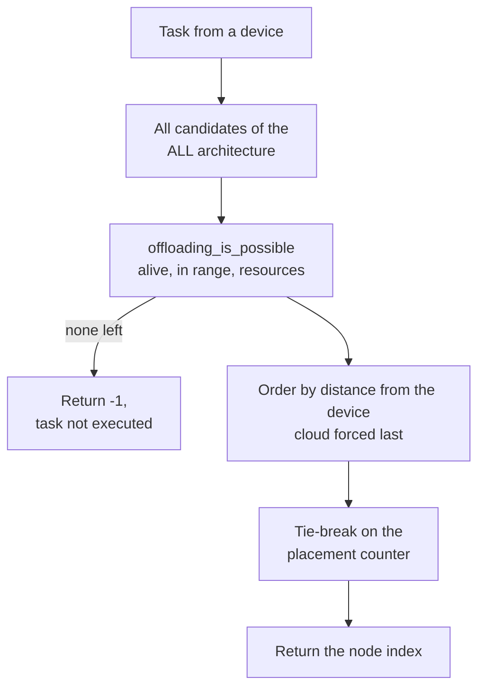

# Custom orchestrator: nearest node

## Why this scenario exists

The placement decision is where a study contributes something new, so the single
most important extension point of the framework is the orchestrator. Anyone
comparing policies needs a minimal, readable replacement to start from, one that
changes the decision rule and nothing else in the simulation.

This is that starting point. The default policy is deliberately removed and a
different instinct put in its place, on an unchanged scenario, so every number
that moves can be attributed to the rule itself.

## What it shows

How to replace the placement policy of PureEdgeSim by subclassing
`Orchestrator`. The built-in `TRADE_OFF` algorithm balances the load of each
candidate against its CPU speed. This example implements the opposite instinct:
give the task to the node closest to the requesting device, so a mist neighbour
wins whenever one is within radio range and the cloud is only a last resort.

`NearestNodeOrchestrator` overrides `find_computing_node`. It filters the
candidates with `offloading_is_possible`, then keeps the nearest one, using the
load counter in `self.history` to break ties. The cloud has no meaningful
distance in this model, so it is pushed to the end of the ordering.



## The scenario

The script runs the same workload twice, with the same seed, so the only
difference is the policy:

- `examples/custom_orchestrator/settings`, 20 devices, five simulated minutes;
- the `ALL` architecture, so mist, edge, and cloud are all candidates;
- `TRADE_OFF` as the algorithm name, `random_seed=7`, no log file;
- the first run uses `DefaultOrchestrator`, the second the custom one.

## Run it

From the repository root, after `pip install -e .`:

```bash
python examples/custom_orchestrator/custom_orchestrator.py
```

## What to look for

```text
orchestration strategy, same seed and same workload:
TRADE_OFF (default)      tasks= 1035 ok=  751 avg_delay=0.2025   cloud= 124 edge= 463 mist= 448 energy=11.5627
nearest node             tasks= 1035 ok=  735 avg_delay=0.2037   cloud=   0 edge= 522 mist= 513 energy=11.4244
```

- The nearest-node policy never selects the cloud, because an edge data center
  or a neighbour is always closer: the 124 cloud placements of the default run
  become 0, and the local tiers absorb them, the edge rising from 463 to 522
  placements and the mist from 448 to 513. The CSV confirms the routing changed,
  not just the labels, the WAN usage column falls from 51.136 s to 0.0 s while LAN
  usage rises from 4.9628 s to 5.7385 s.
- The average delay moves little, and honestly it moves the wrong way, 0.2025 s to
  0.2037 s: the policy saves the WAN round trip but sends more tasks to slower
  mist devices and to busy edge hosts.
- The success count moves against the policy: the 751 of 1035 tasks the default
  run lands fall to 735 under the nearest rule, sixteen fewer. The 45 cloud
  successes vanish with the 0 cloud placements, the edge gains 45 (345 to 390),
  but the mist, handed the traffic the cloud used to absorb, drops from 361
  successes out of 448 placements (80.6 percent) to 345 out of 513 (67.3 percent).
  On this scenario the rule reshapes the placement map and loses tasks rather
  than rescuing any.
- The energy drops slightly, 11.5627 Wh to 11.4244 Wh, because the nearest rule
  removes the cloud host (0.2805 Wh) and its WAN round trip (0.0969 Wh), leaving
  the local Wi-Fi links to carry the traffic.
- Results go to `examples/custom_orchestrator/output/`.

Change the ordering key to see the trade-off: prefer the fastest node instead of
the closest one, and the cloud returns while mist usage falls.

## Files

- `custom_orchestrator.py` with the orchestrator and the two runs
- `settings/` with `simulation_parameters.properties`, `applications.xml`,
  `edge_devices.xml`, `edge_datacenters.xml` and `cloud.xml`

## Where to go next

- [Distributions and mobility](../distributions_and_mobility/README.md) for a
  scenario configured entirely from Python
- [Graph partitioning](../graph_partitioning/README.md) for a policy that routes
  the subtasks of one request to different nodes
