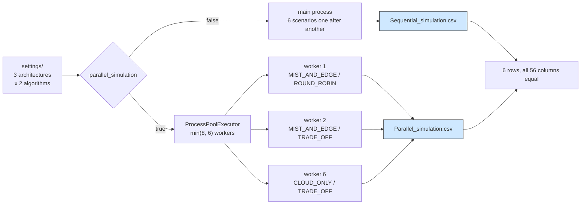

# Custom settings and a parallel sweep: six scenarios in two passes

## What it shows

Two things that the other examples keep separate: a scenario that comes from a
private settings folder instead of the default one, and a sweep over that
scenario run twice, once in the main process and once in worker processes.

The settings folder declares a grid of six scenarios, three architectures by two
algorithms, and the script runs that grid twice with the same seed:

```python
parameters = load_parameters(SETTINGS / "simulation_parameters.properties")
parameters.parallel_simulation = parallel
parameters.random_seed = 42
simulation = Simulation(SETTINGS, output, parameters, load_settings(SETTINGS))
rows = simulation.launch()
```

The claim of the example is that parallelism is a scheduling decision, not a
modelling one: the two passes must produce the same six rows. The script prints
`the two sweeps produced 6 rows each, identical: True` when they do, and the test
compares the rows column by column.



Each worker re-derives its own random stream: `run_scenario` calls
`Randomness.set_seed(parameters.random_seed)` and then `begin_scenario(iteration)`,
so scenario *i* always draws from the seed mixed with *i*, whichever process runs
it. That is why the two passes can be compared at all.

## The scenario

`settings/` holds one fleet of 100 devices, 10 simulated minutes, the six
scenarios above, and `random_seed=` left empty, because an unseeded run is not
reproducible. The script pins seed 42 for both passes so the comparison is
possible; without a seed the two sweeps would differ for that reason alone, not
because of the workers.

## Run it

From the repository root, after `pip install -e .`:

```bash
python examples/custom_settings_parallel/custom_settings_parallel.py
```

The same script runs without installing the package, as long as `src` is on the
path:

```bash
PYTHONPATH=src python examples/custom_settings_parallel/custom_settings_parallel.py
```

## What to look for

The console prints one line per scenario for each pass, then the wall time and the
verdict:

```text
settings folder: D:\Charef\doctorat\Work folder\PyEdgeSim\PureEdgeSim\examples\custom_settings_parallel\settings

sequential  MIST_AND_EDGE  ROUND_ROBIN  devices= 100 tasks= 10150 ok= 1013 avg_delay=0.6084   energy=47.4811
sequential  MIST_AND_EDGE  TRADE_OFF    devices= 100 tasks= 10150 ok= 1014 avg_delay=0.465    energy=47.8248
sequential  ALL            ROUND_ROBIN  devices= 100 tasks= 10150 ok= 1015 avg_delay=0.5916   energy=47.6758
sequential  ALL            TRADE_OFF    devices= 100 tasks= 10150 ok= 1016 avg_delay=0.5287   energy=49.1103
sequential  CLOUD_ONLY     ROUND_ROBIN  devices= 100 tasks= 10150 ok= 1015 avg_delay=0.1575   energy=58.8768
sequential  CLOUD_ONLY     TRADE_OFF    devices= 100 tasks= 10150 ok= 1015 avg_delay=0.1576   energy=58.5877
sequential  6 scenario(s) in 23.06 s wall time

parallel    MIST_AND_EDGE  ROUND_ROBIN  devices= 100 tasks= 10150 ok= 1013 avg_delay=0.6084   energy=47.4811
parallel    MIST_AND_EDGE  TRADE_OFF    devices= 100 tasks= 10150 ok= 1014 avg_delay=0.465    energy=47.8248
parallel    ALL            ROUND_ROBIN  devices= 100 tasks= 10150 ok= 1015 avg_delay=0.5916   energy=47.6758
parallel    ALL            TRADE_OFF    devices= 100 tasks= 10150 ok= 1016 avg_delay=0.5287   energy=49.1103
parallel    CLOUD_ONLY     ROUND_ROBIN  devices= 100 tasks= 10150 ok= 1015 avg_delay=0.1575   energy=58.8768
parallel    CLOUD_ONLY     TRADE_OFF    devices= 100 tasks= 10150 ok= 1015 avg_delay=0.1576   energy=58.5877
parallel    6 scenario(s) in 10.24 s wall time

the two sweeps produced 6 rows each, identical: True
```

## Measured run

The six rows of `output/<timestamp>/Parallel_simulation.csv`, measured 2026-10-28
on seed 42, 100 devices, 10 simulated minutes each. The sequential CSV holds the
same numbers.

| Architecture | Algorithm | Tasks | Successful | Avg delay | WAN time | Request makespan | Energy |
| --- | --- | --- | --- | --- | --- | --- | --- |
| MIST_AND_EDGE | ROUND_ROBIN | 10150 | 1013 | 0.6084 s | 5.7086 s | 4.4269 s | 47.4811 Wh |
| MIST_AND_EDGE | TRADE_OFF | 10150 | 1014 | 0.465 s | 6.7925 s | 3.4962 s | 47.8248 Wh |
| ALL | ROUND_ROBIN | 10150 | 1015 | 0.5916 s | 15.3839 s | 3.8451 s | 47.6758 Wh |
| ALL | TRADE_OFF | 10150 | 1016 | 0.5287 s | 30.9079 s | 4.1262 s | 49.1103 Wh |
| CLOUD_ONLY | ROUND_ROBIN | 10150 | 1015 | 0.1575 s | 563.4337 s | 2.87 s | 58.8768 Wh |
| CLOUD_ONLY | TRADE_OFF | 10150 | 1015 | 0.1576 s | 498.8261 s | 2.87 s | 58.5877 Wh |

Reading the sweep:

- The two passes agree exactly. Six rows, 56 columns each, identical between the
  sequential and the parallel CSV, which is what the seed per scenario buys. The
  parallel pass took 10.24 s against 23.06 s sequential on six scenarios, about
  2.25 times faster with six workers rather than six, because the pool also pays
  process startup.
- Only 10 percent of the workload meets its deadline in any scenario: 1013 to
  1016 of 10150 tasks, and the same number of the roughly 9980 requests. That is a
  property of the ten minute burst against these deadlines, not of the
  architecture, and it is why the rows differ on delay and energy rather than on
  throughput.
- The architecture is where the WAN time goes: 5.71 to 6.79 s with
  `MIST_AND_EDGE`, 15.38 to 30.91 s with `ALL`, 498.83 to 563.43 s with
  `CLOUD_ONLY`. Energy moves the other way, 47.48 to 47.82 Wh at the edge, 47.68 to
  49.11 Wh with all three tiers, 58.59 to 58.88 Wh in the cloud: the cloud tier is
  faster per task, 0.1575 s against 0.465 s, and costs 23 percent more energy.
- `TRADE_OFF` beats `ROUND_ROBIN` on latency only where there is a choice to make.
  On `MIST_AND_EDGE` it cuts the average delay from 0.6084 to 0.465 s and the
  request makespan from 4.4269 to 3.4962 s; on `CLOUD_ONLY` the two algorithms
  cannot differ, 0.1575 against 0.1576 s, because there is exactly one destination
  for every task.
- Parallel mode is not free of side effects, and the run shows them: live charts
  are disabled and the CSV is named `Parallel_simulation.csv`, so the two passes
  land in two timestamped folders and can be diffed. Each folder also carries
  `run.json`, where the parallelism flag records which pass produced the row, and
  a snapshot of the settings that were parsed.

## Tune it

- Clear `random_seed` in the script to see the two passes disagree: without a
  seed the framework draws from an unseeded generator and the comparison becomes
  meaningless.
- Widen the grid, for example by adding `MIST_ONLY`, `SINGLE_EDGE` and device
  counts, and watch the wall time grow linearly in the sequential pass and only
  until the worker count in the parallel one.
- Set `parallel_simulation=true` in the file and call `main()` once to run the
  sweep in the way a real batch would, without the sequential reference pass.

## Files

- `custom_settings_parallel.py` with the two passes and the row comparison
- `settings/` with the six scenario grid, the 100 device fleet and the empty seed

## Where to go next

- [Command line](../../README.md#command-line) for the same sweep run through
  `python -m pureedgesim.cli` instead of a script
- [Custom models](../custom_models/README.md) for the four extension points that
  change what a sweep measures rather than how fast it runs
