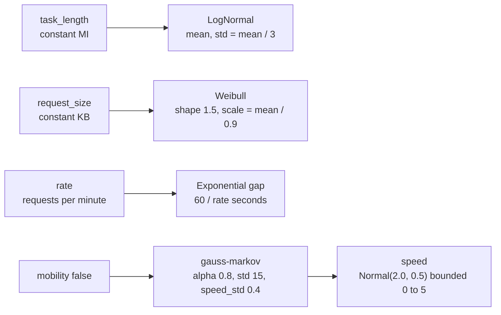

# Distributions and mobility

## Why this scenario exists

A constant workload flatters a placement policy. Every task of a real edge
deployment arrives at its own instant, carries a different payload, and asks for
a different amount of CPU, and a moving device changes the access link it pays
for. Papers that sweep only constants therefore measure the policy under one
point of the workload space.

This scenario runs the same topology twice, first with the file values and then
with those values replaced by their stochastic counterparts, so the difference
between the two rows is the effect of randomness alone. It is also the
demonstration that the configuration can be built from Python: the second run
never edits a file, it rewrites the objects returned by `load_settings`.

## What it shows

How to configure a scenario from Python instead of editing the settings files.
The settings folder describes constants: every task of an application has the
same length, the same sizes, and the same gap between requests, and the devices
stand still. This example loads those files, then replaces the constants by
probability distributions and lets the devices move.

The distributions live in the `pureedgesim` package and are also accepted inside
the XML files. The example uses them directly:



- `LogNormalDistribution` for the task length, with the same mean as the
  constant and a third of it as standard deviation;
- `WeibullDistribution` for the request size;
- `ExponentialDistribution` for the inter-arrival gaps, derived from the rate;
- `NormalDistribution(2.0, 0.5).bounded(0.0, 5.0)` for the speed, so a draw is
  never negative;
- the `gauss-markov` mobility model for every device type, with its `alpha`,
  `std`, and `speed_std` options.

## The scenario

Both runs use `examples/distributions_and_mobility/settings` with 20 devices, five simulated
minutes, the `ALL` architecture, and `random_seed=7`. The first run keeps the
file values; the second replaces them as described above. `Randomness.set_seed`
and `Randomness.begin_scenario` make the draws reproducible across the two runs.

The script also prints a few draws before running, so the shape of each
distribution is visible without reading the CSV: one gap from the heavy
application, and six lognormal task lengths.

## Run it

From the repository root, after `pip install -e .`:

```bash
python examples/distributions_and_mobility/distributions_and_mobility.py
```

## What to look for

```text
constants, static      tasks= 1035 ok=  285 delay=0.1994   failed(delay)= 750 failed(mobility)=   0 energy=11.6627
distributions, mobile  tasks= 1006 ok=  576 delay=0.2129   failed(delay)= 430 failed(mobility)=   0 energy=10.9468
```

- The task count changes (1035 to 1006): the exponential gaps produce a different
  number of requests in the same simulated time.
- Fewer tasks miss their deadline in the second run (750 to 430), so 576 succeed
  against 285, even though the mean delay is higher (0.1994 s to 0.2129 s),
  because the lognormal mix includes many short tasks: the average is dragged up
  by the long draws while the short ones clear their budget. The per-tier columns
  show where the gain is, the mist tier returns 447 successes out of 457
  placements in the distributed run against 195 out of 448 in the constant one.
- `failed(mobility)` stays at zero in both rows: moving devices leave and re-enter
  range, but they are not lost, so mobility changes the destination, not the
  outcome.
- Results go to `examples/distributions_and_mobility/output/`, where both runs are
  appended to one `Sequential_simulation.csv`.

Replace the `gauss-markov` model by `manhattan`, `levy-walk`, or the other models
listed in the README to compare movement patterns under the same workload.

## Files

- `distributions_and_mobility.py` with the parameter overrides and both runs
- `settings/` with `simulation_parameters.properties`, `applications.xml`,
  `edge_devices.xml`, `edge_datacenters.xml` and `cloud.xml`

## Where to go next

- [Custom orchestrator](../custom_orchestrator/README.md) for a different kind
  of Python-side configuration, the placement policy
- The settings folder section of the [main README](../../README.md#settings-folder)
  for the distribution syntax inside the XML files
