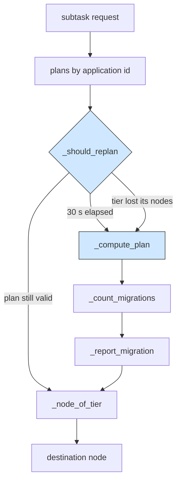

# Dynamic repartition: re-planning a service graph while the simulation runs

## What it shows

Every other partitioning example places a service graph once and keeps that
decision for the whole run. This one re-assigns the tier of each subtask while
the simulation is going on, and it is the only place where that live re-decision
is visible. Open `DynamicRepartitionOrchestrator`, especially `find_computing_node`
and `_should_replan`.

The orchestrator stores a tier plan per application (`self.plans`). On each
request it either reuses the plan or rebuilds it. `_should_replan` triggers a
refresh on two conditions: the cadence, once `REPLAN_INTERVAL = 30.0` seconds
have passed since the last plan, and the trigger, an immediate re-plan as soon as
a planned tier has lost every available node (`_has_available_node` returns
false for a tier whose devices all moved out of range or died). When it fires,
`_compute_plan` rebuilds a tier for every stage from the current queues and CPU
use, and `_count_migrations` plus `_report_migration` print which stages changed
tier. `orchestrate` also clears `task.source_device.application_placed`, because
a plan that changes over time cannot survive the manager's per-device placement
cache.



## The scenario

200 devices run a seven-stage video analytics graph over a 2000 by 2000 map
served by four edge data centers and one cloud. The four data centers sit at the
corners (dc1 500,500; dc2 500,1500; dc3 1500,500; dc4 1500,1500) and are wired in
a ring through the MAN (dc1 to dc2 to dc3 to dc4 to dc1). The graph stages and
their work are capture 2000 MI, preprocess 6000, detect 80000, classify 50000,
track 15000, aggregate 3000, notify 500, with a 12 second end-to-end deadline at
4 requests per minute. The architecture is `ALL` and the algorithm is `TRADE_OFF`,
`random_seed` is 42, and the run is 10 simulated minutes (`wait_for_all_tasks`
drains the tail to 615 s). Tier weights mirror the trade-off, CLOUD 1.8, MIST 1.3,
EDGE 1.2, and `enable_orchestrators=false` so the orchestrator runs on the device
and a mist stage can be hosted by the requesting device itself.

## Run it

From the repository root, after `pip install -e .`:

```bash
python examples/dynamic_repartition/dynamic_repartition.py
```

The same script runs without installing the package, as long as `src` is on the
path:

```bash
PYTHONPATH=src python examples/dynamic_repartition/dynamic_repartition.py
```

Add `--frozen` to compute the plan once on the first request and never update it
(the static baseline, zero migrations); an optional device count and output folder
shrink the run.

## What to look for

```text
DynamicRepartitionOrchestrator - 615.0 s: application 0 repartitioned, 5 subtask(s) moved, 88 so far
    capture: Edge -> Cloud
    preprocess: Cloud -> Edge
    detect: Edge -> Cloud
    classify: Cloud -> Edge
    track: Edge -> Mist
DynamicRepartitionOrchestrator - dynamic plan: 21 replans, 88 subtasks moved
dynamic  devices= 200 tasks= 56000 ok= 52726 requests_ok= 7298/8000  avg_makespan=5.473    cloud=23582 edge=23791 mist= 6055 failed(delay)=  702 energy=1976.0552
```

- The 56000 tasks are 8000 requests times the seven stages, so the plan is rebuilt
  21 times across the run and 88 stages change tier between them. The log prints one
  block per re-plan that moved at least one stage, and the lines above are the last
  of them, at the 615 s mark where `wait_for_all_tasks` drains the tail. Read back
  through the log and the oscillation is visible: `capture: Edge -> Cloud` at
  615.0 s, `Cloud -> Edge` at 585.0 s, and the same alternating pair at 135.0 s and
  165.0 s, as the queues fill and drain at each tier.
- Request success is the honest headline: 7298 of 8000 requests finish, with an
  average makespan of 5.473 s against the 12 s deadline, so half the budget is left
  over. Only 702 subtasks miss their latency bound. The CSV column "Tasks not
  executed because a dependency failed" is 2572: when a stage does miss its bound,
  the stages that depend on it are skipped, and that accounts for the rest of the
  workload (52726 successes + 702 delay failures + 2572 skipped = 56000).
- The tier loads are lopsided and explain why the plan keeps moving. Average CPU
  usage on the edge tier is 57.56% while cloud is 9.03% and mist is 6.02%, even
  though the two fixed tiers end with almost the same number of subtasks (23791 at
  the edge, 23582 on the cloud), because the four data centers pool far fewer cores
  than the cloud's 200. The plan pushes work to cloud whenever edge saturates. Mist
  is still the least reliable tier, but the gap is narrow now: 5354 of the 6055
  subtasks planned there succeed (88.4%), and 701 of the 702 delay failures are mist
  stages, against 23582 of 23582 on the cloud and 23790 of 23791 at the edge (both
  100.0%). Nothing is lost to mobility (0 tasks) and no device died, so those
  failures are cheap stages landing on a slow peer, not on a neighbour that moved
  out of range.
- Energy is 1976.06 Wh, and it is the device fleet that pays for it, not the
  re-planning: the mist energy column alone is 1794.75 Wh of that total, against
  90.04 Wh for the four edge data centers and 91.27 Wh for the cloud. The cellular
  link accounts for 133.45 Wh in the separate per-link columns (with 68.08 Wh on the
  WAN and 1.01 Wh on Wi-Fi), so the access technology is a detail here
  compared with 200 devices, 45% of them battery powered smartphones and vehicles,
  running stages for ten minutes (average remaining battery power at the end is
  35.8% of capacity).

Run with `--frozen` and the migration count drops to zero on the same seed; the
gap between the two rows is the price, and the gain, of re-planning live.

## Files

- `dynamic_repartition.py` with `DynamicRepartitionOrchestrator` and the two modes
- `settings/` with the video analytics graph, the four ring data centers, and the
  200-device parameters

## Where to go next

- [Graph partitioning](../graph_partitioning/README.md) for cutting the same kind
  of service graph into partitions, but computed once and frozen
- [Genetic partitioning](../genetic_partitioning/README.md) for searching the node
  of every subtask with a genetic algorithm on a static placement
