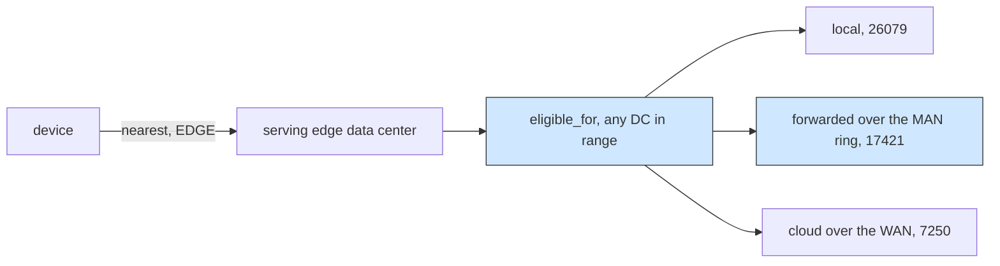

# Edge cooperation: an orchestrator on the edge that forwards to a neighbour

## What it shows

`custom_orchestrator` puts one policy in a single global object. Here the
orchestrator itself lives on an edge data center (`deploy_orchestrator=EDGE` with
`enable_orchestrators=true`), and the interesting question is whether that data
center keeps a task or hands it to a neighbour through the MAN ring. Open
`CooperativeEdgeOrchestrator`, especially `eligible_for`.

The Python core's base rule (`Orchestrator.offloading_is_possible`) restricts an
edge data center to the one already serving the device, so on a ring no task would
ever leave its own server and the links would stay idle. `eligible_for` relaxes
that: any edge data center the device still reaches inside
`edge_datacenters_coverage` is offered as a destination, scored by the same
`trade_off` rule, which is how a task gets forwarded to a neighbour. The counters
`local`, `forwarded`, and `cloud` and the MAN traffic are printed in
`on_simulation_end`, proving the ring carried work.



## The scenario

500 devices on a 2000 by 2000 map, four edge data centers at the corners wired in
a ring through the MAN (dc1 to dc2 to dc3 to dc4 to dc1), and one cloud data
center. Three applications generate the load: Health (Hard Real-time, 20 requests
per minute, 0.02 s deadline, 500 MI), Augmented reality (Soft Real-time, 30 per
minute, 0.5 s, 5000 MI, 1500 KB request), and HEAVY_COMP_APP (Normal, 3 per
minute, 300 s, 30000 MI). The architecture is `EDGE_AND_CLOUD` and the algorithm
`TRADE_OFF`, the run is 10 simulated minutes, and `random_seed` is left empty, so
the numbers vary between runs. `edge_devices_range` is only 10 m, which is why the
mist tier never appears in the results.

## Run it

From the repository root, after `pip install -e .`:

```bash
python examples/edge_cooperation/edge_cooperation.py
```

The same script runs without installing the package, as long as `src` is on the
path:

```bash
PYTHONPATH=src python examples/edge_cooperation/edge_cooperation.py
```

Set `enable_orchestrators=false` in the settings to make every device decide for
itself; then nothing is forwarded and the ring stays empty, which is the clean
comparison for this example.

## What to look for

```text
CooperativeEdgeOrchestrator - served by 4 edge orchestrators: 26079 local, 17421 forwarded over the MAN ring, 7250 to cloud, MAN usage 6021.572 s
EDGE_AND_CLOUD   devices= 500 tasks= 50750 ok=  5250 avg_delay=0.1586   cloud= 7250 edge=43500 mist=    0 failed(delay)=45500 energy=237.9948
```

Results go to `examples/edge_cooperation/output/`. Both blocks are measured, not
in the same launch: `random_seed` is empty, so the split between local and
forwarded, and the energy column, move from run to run (the launch that printed
the line above ended at 238.34 Wh, the CSV on disk records 237.99 Wh), while the
task totals repeat because the workload and the topology do not.

- Cooperation really happens. All 500 devices fall within the 1000 m coverage of
  the corner data centers, so all four act as orchestrators, and of the 43500 tasks
  that ran at the edge tier, 17421 were forwarded to a neighbour over the ring.
  Those two counts add to the CSV edge total (26079 local + 17421 forwarded =
  43500), and adding the 7250 cloud tasks accounts for all 50750 generated tasks.
- Success is deliberately low, 5250 of 50750 tasks, and the reason is visible in
  the app list: the Health application demands a 0.02 s response. A forwarded task
  pays 0.01 s per MAN hop on top of queuing, so 45500 tasks fail on delay.
  Cooperation balances the load but cannot rescue a sub-frame deadline, and that is
  the honest trade-off of routing to a neighbour instead of dropping locally.
- The MAN carries the time, not the energy. MAN usage is 6021.572 s of transfer
  time in the printed run, yet the CSV "MAN energy consumption" column is 0.00 Wh
  because `man_nanojoules_per_bit=0`. Most of the 237.99 Wh is spent by the mobile
  fleet (the mist energy column is 150.93 Wh, the edge column 78.47 Wh, the cloud
  column 8.59 Wh), and the per-link accounting puts 285.50 Wh on the cellular
  access, while the edge tier runs at 28.14% average CPU.
- Mist is empty (`mist=0`): with a 10 m device range no device can host a
  neighbour's task, so the whole fleet is split between edge and cloud only. The
  mist energy column above is the devices drawing power for their own tasks, not
  for hosting one another's.

## Files

- `edge_cooperation.py` with `CooperativeEdgeOrchestrator` and the counters
- `settings/` with the four ring data centers, the 500-device fleet, and the three
  applications

## Where to go next

- [Custom orchestrator](../custom_orchestrator/README.md) for a single global
  placement policy instead of one running on each edge data center
- [Dynamic repartition](../dynamic_repartition/README.md) for an edge ring that is
  re-planned live instead of decided task by task
