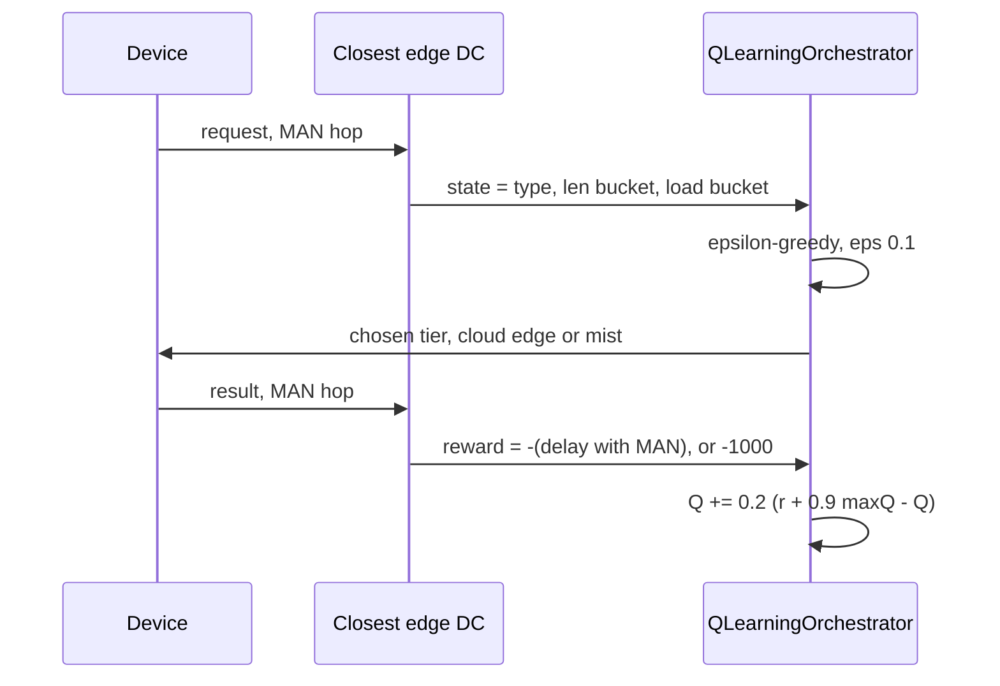

# Edge-orchestrated Q-learning: the tier agent handed to an edge data center

## What it shows

The same learned tier policy as `examples/q_learning`, but the decision no longer
happens on the device. `enable_orchestrators` = true with `deploy_orchestrator` =
EDGE routes every request to the closest edge data center first, which adds a MAN
round trip before and after the placement. The agent itself is imported, not
copied: `QLearningOrchestrator` still scores states, picks a tier and updates the
table. Open `reward` and `results_returned`: the delay the agent is charged for
now contains that MAN hop, so the value it learns for a tier includes the cost of
delegating the choice, and a policy that looks good on-device can look worse here.
Read `initialize` and `node_in_tier` for the part that did not change.



## The scenario

`settings/` is the neighbourhood-scale version of the Q-learning example:

- 500 devices on a 2000 by 2000 meters map, with a 20 meters device-to-device
  range;
- the `ALL` architecture and the `Q_LEARNING` algorithm, `random_seed` = 7, ten
  simulated minutes, `enable_orchestrators` = true and `deploy_orchestrator` =
  EDGE, so the orchestrator runs on the edge tier;
- four linked edge data centers of 10 cores at 40000 MIPS and a cloud of 200
  cores;
- five device types (phones, tablets, laptops and two non-computing sensors) and
  the same three applications.

## Run it

From the repository root, after `pip install -e .`:

```bash
python examples/edge_orchestrated_q_learning/edge_orchestrated_q_learning.py
```

No-install variant:

```bash
PYTHONPATH=src python examples/edge_orchestrated_q_learning/edge_orchestrated_q_learning.py
```

## What to look for

```text
edge orchestrated  tasks= 56550 ok= 5850 avg_delay=0.1622 cloud=48180 edge=7095 mist=1275 energy=236.1275
```

- 48180 of 56550 tasks, roughly 85 percent, end up on the cloud, and 50700 fail
  on delay, so only 5850 succeed. Delegation did not make the learner pick
  smarter, it pushed it harder toward the tier that drains the fastest per task
  once every request first crosses the MAN link.
- The average completed delay, 0.1622 s, is the lowest of the family, and that is
  the honest read: it is low because the latency bound filtered out everything
  slow, leaving only quick successes in the average, not because the policy got
  better. The success rate (5850 over 56550, about 10 percent) is far below the
  on-device Q-learning run, so this is a regression on throughput bought with a
  lower per-task delay.
- Energy is 236.13 Wh for ten simulated minutes across 500 devices, the largest
  number in the family. The per-tier split says where it goes: mist 120.08 Wh,
  edge 73.29 Wh and cloud 42.75 Wh, so the bill is the fleet plus the four data
  centers running, and inside it the access links account for 47.05 Wh of Wi-Fi
  against 0.01 Wh on the WAN, far less than a cloud-heavy placement suggests.
- Results go to `examples/edge_orchestrated_q_learning/output/`, where the CSV
  holds this full scenario as a single row, so every number above is readable
  from it.

Set `enable_orchestrators` = false in `settings/` to run the agent back on the
device and watch the cloud share fall.

## Files

- `edge_orchestrated_q_learning.py`, a thin wrapper around the shared agent
- `../q_learning/q_learning.py` for `QLearningOrchestrator` itself
- `settings/` with `simulation_parameters.properties`, `applications.xml`,
  `edge_devices.xml`, `edge_datacenters.xml` and `cloud.xml`

## Where to go next

- [Q-learning](../q_learning/README.md) for the on-device version of this exact
  agent
- [Custom orchestrator](../custom_orchestrator/README.md) for a hand-written
  placement rule to compare the learned one against
- [Custom policies](../../README.md#custom-policies) in the main README
