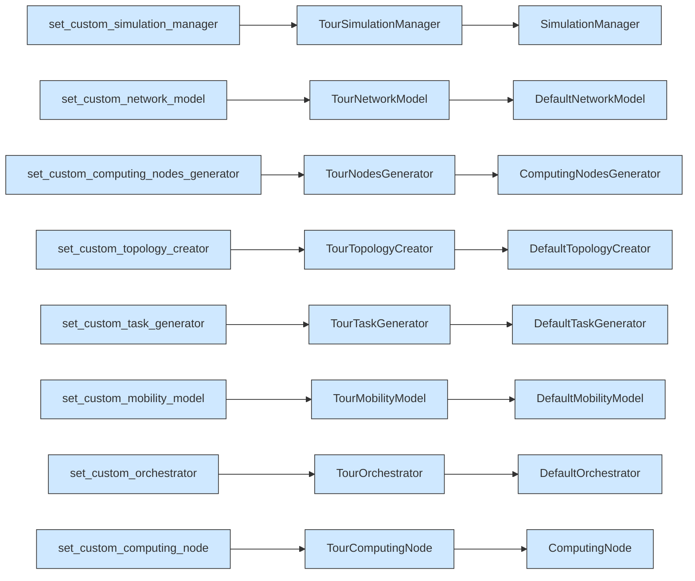

# Extension points: the eight Simulation setters in one file

## What it shows

PureEdgeSim is built from interchangeable models, and `Simulation` exposes one
setter per model, but no other example registers all of them at once. This file is
a tour of the whole wiring API, so the intent is different from every other
custom example: it must prove that injecting a model that only observes changes
nothing. Open `extension_points.py` and the eight `set_custom_...` calls at the end
of the `simulation()` function.

Each registered class is a thin `Tour...` subclass that counts its own calls,
prints the first one through `record`, and then delegates to the default it
extends, so the scenario is untouched. The simulation is therefore launched twice,
once with the stock models and once with the tour, and the two CSV rows must be
identical. That equality is the point, a wiring operation that observes must be a
no-op on the result, exactly like registering a Java default explicitly does
nothing.



## The scenario

The settings folder ships the seven architecture by two algorithm sweep of the
Java defaults (CLOUD_ONLY through ALL, TRADE_OFF and ROUND_ROBIN, 100 to 300
devices on a 200 by 200 map with one edge data center and one cloud). The script
shrinks that to a single short run so the tour stays readable: it overrides to 20
devices, 300 simulated seconds, the `ALL` architecture, the `TRADE_OFF` algorithm,
`random_seed=7`, and no log file. It then launches that one scenario twice, once
stock and once with the eight tour classes chained onto the `Simulation`.

## Run it

From the repository root, after `pip install -e .`:

```bash
python examples/extension_points/extension_points.py
```

The same script runs without installing the package, as long as `src` is on the
path:

```bash
PYTHONPATH=src python examples/extension_points/extension_points.py
```

An optional device count and output folder shrink the tour further.

## What to look for

```text
stock models                 tasks= 1035 ok=  285 avg_delay=0.1994   energy=11.6627  cpu=0.5838%
eight custom models          tasks= 1035 ok=  285 avg_delay=0.1994   energy=11.6627  cpu=0.5838%

same results with and without the custom classes: True
```

- The headline is `same results with and without the custom classes: True`, and it
  is not just a printed flag. The newest timestamped folder holds one
  `Sequential_simulation.csv` with two rows, the stock run and the toured run, and
  all 56 columns match byte for byte, tasks 1035, ok 285, average delay 0.1994 s,
  energy 11.6627 Wh, CPU 0.5838%. Because every observer only delegates, injecting
  the eight models changes no measurement.
- The per-hook usage counts show which extension points the framework really calls
  in one run: the computing node hook fires 8053 times (every task event, status
  tick, and transfer on all 22 nodes), the network model 2070 times, the
  orchestrator 665 times (fewer than the 1035 tasks because the manager caches a
  placement per device, so the custom orchestrator sees only the first task of each
  device), and the mobility model exactly 20 times, one path per mobile device.
- The "first use" line is a sanity check, not a result: it names the class the
  framework chose, for example `1 cloud, 1 edge, 20 devices` from the nodes
  generator and 84 directed links from the topology creator, which is the wiring
  you are overriding.

## Files

- `extension_points.py` with the eight `Tour...` classes and the two launches
- `settings/` with the stock scenario the tour observes but does not change

## Where to go next

- [Custom orchestrator](../custom_orchestrator/README.md) for what happens when
  one of these setters, `set_custom_orchestrator`, replaces real behaviour instead
  of only observing it
- [Custom computing node](../custom_computing_node/README.md) for `set_custom_computing_node`
  used the same way but with a node that adds its own event
