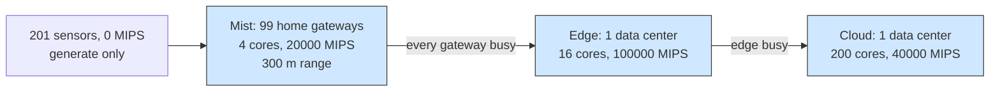

# Fog layers: fill the mist, then overflow outward

## What it shows

A fog deployment is concentric: home gateways sit closest to the sensors, one
neighbourhood edge data center sits behind them, and the cloud is the last
resort. `FogLayersOrchestrator` encodes that intuition as a walk. It tries the
layers in the fixed order mist, edge, cloud, stops at the first layer that holds
a node able to run the task, and takes the least loaded node of that layer. The
consequence is that the near gateways absorb as much work as they can and only
the true overflow leaves the mist.

The orchestrator keeps its own picture of how many tasks are in flight on each
candidate. `find_computing_node` walks `PREFERENCE`, calls `_least_loaded_in`
for the first usable layer, and increments that node's pending count;
`results_returned` decrements it when the result comes back. A strict `<` in the
inner loop keeps the first idle node of a layer when two are equally loaded, so
a sensor's tasks spread gateway by gateway instead of piling on one. Because the
policy implements the hierarchy itself, no container registry and no delegated
orchestrator are needed, and the sensors, which have no CPU, always exercise it:
their task cannot run at home, so it starts at a gateway and only moves outward
when the gateways are busy.



## The scenario

`settings/` describes a smart home:

- 300 devices on a 2000 by 2000 meters map: 67 percent sensors that only generate
  tasks (201 devices), and 33 percent home gateways that only execute (99 gateways,
  4 cores at 20000 MIPS each);
- a 300 meters device-to-device range, wide enough that a sensor sees the
  gateways of its neighbourhood;
- one edge data center at the centre of the map, 16 cores at 100000 MIPS, plus
  one cloud data center of 200 cores at 40000 MIPS;
- the `ALL` architecture and the `FOG_LAYERS` algorithm, five simulated minutes,
  seed 42, decisions made on the device (`enable_orchestrators=false`), no
  registry, Wi-Fi access only;
- the three default applications, Health (20 percent, 500 MI, 20 ms), Augmented
  reality (30 percent, 5000 MI, 0.5 s) and HEAVY_COMP_APP (50 percent, 30000 MI).

## Run it

From the repository root, after `pip install -e .`:

```bash
python examples/fog_layers/fog_layers.py
```

No-install variant:

```bash
PYTHONPATH=src python examples/fog_layers/fog_layers.py
```

## What to look for

The console ends with the layer summary and the result row:

```text
FogLayersOrchestrator - placements per layer: Mist=4129, Edge=2
FOG_LAYERS       devices= 300 tasks= 14515 ok= 10502 failed(delay)= 4013 avg_delay=0.316    cloud=   0 edge=  30 mist=14485 energy=40.1415
```

| Layer | Placement decisions | Tasks executed |
| --- | --- | --- |
| Mist (gateways) | 4129 | 14485 |
| Edge (data center) | 2 | 30 |
| Cloud | 0 | 0 |

- The hierarchy does what it promises. Of the 14515 generated tasks, 14485 run on
  the mist gateways and only 30 overflow to the edge, and none reaches the cloud.
  The two edge placement decisions become 30 executed tasks because a device
  reuses its first placement for later tasks.
- The `pending` count is what makes the overflow happen. The 99 gateways carry
  396 cores in total against 201 sensors, so their queues build, and a sensor
  whose own neighbourhood is saturated is pushed to the edge rather than waiting.
- The nearest layer now finishes most of its work in time. The old latency penalty
  came from transfers being rounded up to the next one-second poll; with the exact
  completion time, 10502 of 14515 tasks succeed with seed 42, 72.35 percent, and
  only 4013 miss their latency budget while the average compute time stays at
  0.316 s. A quarter-tier mist no longer trades away most of the soft real-time
  and hard real-time traffic to stay close to the sensor.
- The energy follows the placement: 31.257 Wh of the 40.1415 Wh total is drawn by
  the mist fleet and only 8.8845 Wh by the idle edge server. The WAN carries 0.0 s
  and the MAN 0.0 Wh, because every task stops at a gateway or the edge data
  center and none climbs to the cloud, so the WAN gateway that `dc1` hangs on never
  carries traffic; the whole 16.9721 Wh of network energy is Wi-Fi on the LAN.

Raise the gateway share above 33 percent, or shrink `edge_devices_range`, to move
the balance: more mist capacity lifts the success rate, a narrower range pushes
more overflow to the edge.

Results go to `examples/fog_layers/output/`.

## Files

- `fog_layers.py` with `FogLayersOrchestrator` and the single run
- `settings/` with `simulation_parameters.properties`, `applications.xml`, the
  sensor and gateway fleet in `edge_devices.xml`, `edge_datacenters.xml` and
  `cloud.xml`

## Where to go next

- [Multi-access MEC](../multi_access_mec/README.md) for a placement that scores
  each tier instead of walking a fixed layer order
- [Self clustering](../self_clustering/README.md) for keeping work inside an
  elected neighbourhood rather than a physical layer
