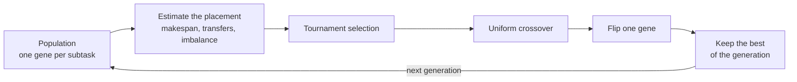

# Genetic partitioning: searching a subtask placement

## Why this scenario exists

The graph cut of the [other partitioning example](../graph_partitioning/README.md)
optimises the structure of the dependency graph, which is blind to two things that
matter on a real deployment: how long a stage actually takes on a machine of a
given speed, and what the intermediate result costs to move between tiers.

This example poses the same question as a search over placements instead, with an
objective built from the estimates the simulator itself uses. Running both on the
identical workload is what makes the comparison honest: if a learned or searched
placement does not beat the structural cut on the same graph, the structure was
not the binding constraint.

## What it shows

The same service graph as the [graph partitioning example](../graph_partitioning/README.md),
solved differently. Instead of deriving a cut from the structure of the graph,
`GeneticPartitioner` searches the node of every subtask:

- a chromosome holds one gene per subtask, and a gene names a candidate node
  (a mist device, an edge data center, or the cloud);
- fitness is the estimated makespan of the pipeline, plus part of the time spent
  transferring results between nodes and of the excess work of the busiest node
  over the average of the nodes actually used;
- selection is by tournament, crossover is uniform, mutation flips one gene, and
  the best chromosome of each generation is kept.



The plan the search converges to prints as one node per stage, which is the
whole placement:

```text
capture  preprocess  detect  classify  track   aggregate  notify
Mist#65  Mist#65     Mist#64 Mist#54   Edge#2  Mist#54    Mist#54
```

Subtasks that receive the same node form the same partition, so the search
implicitly decides where to cut the graph.

The plan is static: it is computed once, from the mean task lengths and result
sizes, before any device moves. When the chosen node is not eligible for a
request (a mist device that is now out of range, for example), the subtask falls
back to `TRADE_OFF`.

`GeneticOrchestrator` clears the application placement after each decision, as
the graph example does, so every subtask is routed on its own.

## The scenario

`examples/genetic_partitioning/settings` is the scenario of the graph example: 150
devices on a 2000 by 2000 meters map, four linked edge data centers, the `ALL`
architecture, five simulated minutes, and the same 60/40 split between the graph
application and a monolithic one.

The solver seed comes from `random_seed` in the settings file, and defaults to
`20261026` when the file leaves it empty. With seed 42 the run is reproducible.

## Run it

From the repository root, after `pip install -e .`:

```bash
python examples/genetic_partitioning/genetic_partitioning.py
```

## What to look for

The console prints the estimated fitness and the node chosen for every subtask:

```text
GeneticOrchestrator - Application 0 (Soft Real-time): fitness 0.0768 (makespan 0.0697 s, transfers 0.0011 s, imbalance 0.6244)
  {'capture': 'Mist#65', 'preprocess': 'Mist#65', 'detect': 'Mist#64', 'classify': 'Mist#54', 'track': 'Edge#2', 'aggregate': 'Mist#54', 'notify': 'Mist#54'}

tasks= 9600 ok= 9600 avg_delay=0.0252   cloud= 987 edge=5852 mist=2761 failed(dependency)=   0 energy=47.8312
```

- The fitness is an estimate made before the run, so compare it with the cut of
  the graph example rather than with the measured delay.
- The search keeps most of the pipeline close to the devices and sends stages to
  the edge only when the estimated transfer cost pays off: six of the seven stages
  land on mist devices, only `track` goes to `Edge#2`.
- Every task succeeds now. All 9600 generated tasks clear their bound and 0 fail
  on delay, so the reading is a clean sweep rather than the partial success the
  old polling model reported. No task is lost to a failed dependency either, that
  column is 0. The per-tier success counts confirm it: mist completes 2761 of 2761
  placements, the edge 5852 of 5852, and the cloud 987 of 987, all at 100 percent,
  because a transfer that ends at its exact completion time no longer pushes a
  stage past its latency budget.
- Against the graph cut of the other example, on the same scenario, both now clear
  every task: 9600 successes each and all 5400 requests completed, so success no
  longer separates them. The search wins on efficiency instead. Its average request
  makespan is 0.0748 s against the cut's 0.121 s, its total traffic is 408.283 MBytes
  against 463.615, and it sends only 987 tasks to the cloud against the cut's 3537,
  because it keeps six of the seven stages on mist devices. With the latency budget
  met by both, the binding constraint on this workload is now how much work and how
  many bytes cross the tiers, not the per-stage deadline.
- Results go to `examples/genetic_partitioning/output/`.

Set `random_seed` in the settings file and remove it again to see the plan
change for the same scenario.

## Files

- `genetic_partitioning.py` with the orchestrator and the run
- `../../src/pureedgesim/partitioning.py` with `Candidate` and
  `GeneticPartitioner`, shared with the graph example
- `settings/` with the five PureEdgeSim files, `applications.xml` holding the
  service graph

## Where to go next

- [Graph partitioning](../graph_partitioning/README.md) for the cut-based
  solution to the same problem
- The service graph section of the [main README](../../README.md#service-graphs)
  for the XML syntax and the dependency semantics
