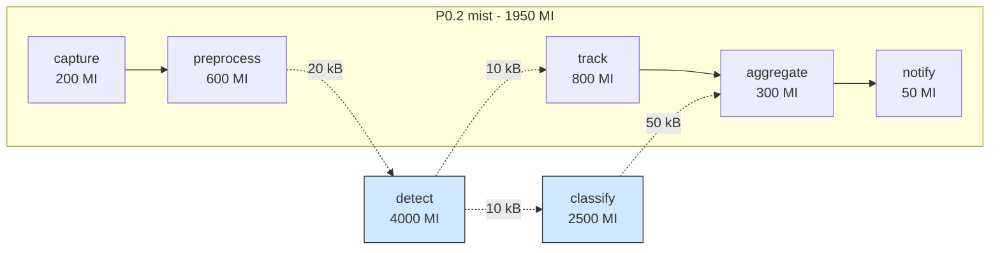

# Graph partitioning: cutting a service graph with graph theory

## Why this scenario exists

A service graph is usually placed as one unit: the whole pipeline runs on one
node, so the slowest stage sets the makespan and that node carries all of the
work. Splitting the pipeline across tiers is the standard lever, and it is a
combinatorial problem, not a scheduling one: where to cut decides both the
pipelined execution time and how many intermediate results cross the network.

This scenario fixes the workload and the topology, and shows that the cut alone
moves a request between tiers. It is the reference point for comparing any other
placement strategy on the same graph, including the genetic one.

## What it shows

How to route the subtasks of one request to different nodes. The applications
file declares a video analytics pipeline: seven subtasks connected by
dependencies, from `capture` to `notify`, so one request produces a small graph
instead of a single task.

Before the simulation starts, `GraphPartitioner` cuts that graph:

1. it finds the weakly connected components of the dependency graph;
2. inside each component it assigns the heaviest subtasks first to the least
   loaded partition (longest processing time first);
3. it then swaps pairs of subtasks between partitions while the swap removes
   more dependency edges than it adds, and while no partition exceeds the
   balance tolerance.

`GraphPartitioningOrchestrator` maps the resulting partitions to the available
tiers in the order mist, edge, cloud. The subtask name and the application
identifier select the partition at runtime, and the orchestrator picks the next
eligible node of that tier in round robin.

The plan printed below is the same graph, so the figure and the console agree:
`detect` and `classify` are pulled out of the big partition because they are the
two heaviest stages, and the four dashed edges are what has to cross the network
at runtime.



## The API detail this example exists to show

PureEdgeSim caches an application placement: after the first decision, later
tasks of the same device reuse the same destination. A per-subtask plan needs
the opposite. The Python orchestrator therefore clears the flag after every
decision:

```python
def orchestrate(self, task, application_id: int = 0):
    destination = super().orchestrate(task, application_id)
    task.source_device.application_placed = False
    return destination
```

The base method returns the destination, so the override must return it too.
Without those lines, only the first subtask of each request would follow the
plan and the others would go to the same node.

## The scenario

`examples/graph_partitioning/settings` describes:

- 150 devices on a 2000 by 2000 meters map, with a 50 meters device-to-device
  range so a requesting device can reach a few neighbours;
- four linked edge data centers, so each tier has more than one candidate;
- the `ALL` architecture and `TRADE_OFF` as the fallback;
- five simulated minutes, a fixed seed of 42, and no container registry;
- a 60 percent share for the graph application and 40 percent for a monolithic
  application, which shows that both styles can coexist.

The orchestrator runs on the device itself (`enable_orchestrators=false`), so a
mist partition can be hosted by the requesting device.

## Run it

From the repository root, after `pip install -e .`:

```bash
python examples/graph_partitioning/graph_partitioning.py
```

## What to look for

The console prints the plan before the run starts:

```text
GraphPartitioningOrchestrator - Application 0 (Soft Real-time): 3 partitions, cut 4 edges (720000 bits per request)
  P0.0 ['detect'] (4000 MI)
  P0.1 ['classify'] (2500 MI)
  P0.2 ['capture', 'preprocess', 'track', 'aggregate', 'notify'] (1950 MI)
tasks= 9600 ok= 9600 avg_delay=0.024    cloud=3537 edge=4350 mist=1713 failed(dependency)=   0 energy=49.3512
```

- The cut counts how many dependency edges cross a partition boundary, and the
  traffic is the result size of their parents, which is what must travel between
  nodes at runtime.
- The three partitions go to mist, edge, and cloud, so the run uses all three
  tiers.
- Every generated task succeeds, and no task is lost to a failed dependency.
- Results go to `output/partitioning/`.

Change `PARTITIONS_PER_COMPONENT` to see the trade-off: more partitions spread
the load further but cut more edges.

## Files

- `graph_partitioning.py` with the orchestrator and the run
- `../../src/pureedgesim/partitioning.py` with `ServiceGraph` and
  `GraphPartitioner`, shared with the genetic example
- `settings/` with the five PureEdgeSim files, `applications.xml` holding the
  service graph

## Where to go next

- [Genetic partitioning](../genetic_partitioning/README.md) for the same problem
  solved by a search instead of a graph cut
- The service graph section of the [main README](../../README.md#service-graphs)
  for the XML syntax and the dependency semantics
