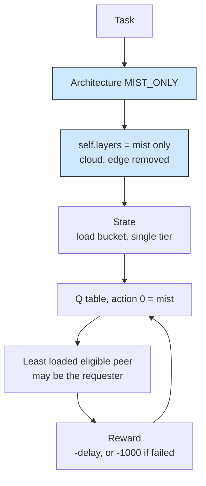

# Mist-only Q-learning: the same agent with no tier to choose

## What it shows

What is interesting here is what the learning loop looks like once you take the
tier decision away. The `MIST_ONLY` architecture removes the cloud and the edge
data centers from the action space, so the agent of `examples/q_learning` runs
unchanged and its only remaining action is the mist. Open `initialize` in
`QLearningOrchestrator`: it fills `self.layers` by keeping only the tiers the
architecture allows, and with one layer left `choose_action`, `node_in_tier` and
the reward bookkeeping still run but now learn which nearby device gives the
lowest delay rather than which tier. The device that wins can be the one that
made the request, since a mist peer includes the requester. Nothing in the script
overrides the class, exactly as the Java Example 14 reuses the Example 11 class.



## The scenario

`settings/` keeps the Q-learning agent and swaps the fleet and the map:

- 200 devices on a 500 by 500 meters map, with a wide 100 meters device-to-device
  range so each request has several mist peers to choose from;
- the `MIST_ONLY` architecture and the `Q_LEARNING` algorithm, `random_seed` = 42,
  five simulated minutes, decisions made on the device;
- three device types, all of which both generate and execute tasks and none of
  which is a sensor: smartphone (40%, 10000 MIPS, mobile), tablet (30%,
  20000 MIPS) and laptop (30%, 50000 MIPS);
- the same three applications, so Hard, Soft and Non Real-time still separate the
  states even though only one tier is reachable.

The cloud and edge files are present but excluded by the architecture.

## Run it

From the repository root, after `pip install -e .`:

```bash
python examples/mist_only_q_learning/mist_only_q_learning.py
```

No-install variant:

```bash
PYTHONPATH=src python examples/mist_only_q_learning/mist_only_q_learning.py
```

## What to look for

```text
mist only                tasks= 14500 ok= 11309 avg_delay=0.2539   cloud=    0 edge=    0 mist=14500 failed(delay)= 3191 failed(mobility)=   0 energy=48.5838
```

- Every one of the 14500 tasks is placed on the mist (cloud and edge counts are
  exactly 0), which confirms the action space really collapsed to a single tier;
  the agent no longer chooses where to offload, it learns which peer is idle.
- 11309 tasks succeed and 3191 fail on delay, for an average completed delay of
  0.2539 s, higher than the tier-selecting runs (0.1742 s on the device with all
  three tiers open, 0.1649 s with the orchestrator on the edge tier): a fleet of
  phones, tablets and laptops cannot drain a 30000 MI HEAVY_COMP_APP the way the
  cloud can. What the fresh numbers change is the shape of the price. Keeping every
  request in the mist costs time, not success: 78.0% of the tasks clear their
  latency bound here, against 74.4% for the tier-selecting run on the same agent,
  because a request that never leaves the neighbourhood never queues behind the
  shared WAN link either, and the CSV waiting-time column is 0.0 s for the whole
  run. The 3191 failures are the stages a local peer cannot finish in time at all.
- Energy is 48.58 Wh, and the CSV shows the split: the mist layer carries the
  compute at 39.72 Wh while the idle edge data center still draws 8.86 Wh even
  though it runs nothing; the cloud column is 0.00 Wh, and the separate per-link
  accounting puts all 16.05 Wh of the network energy on peer-to-peer Wi-Fi, with
  0.00 Wh on the WAN.
- Results go to `examples/mist_only_q_learning/output/`.

Widen or narrow `edge_devices_range` in `settings/` to change how many peers the
agent can learn between.

## Files

- `mist_only_q_learning.py`, a thin wrapper around the shared agent
- `../q_learning/q_learning.py` for `QLearningOrchestrator` itself
- `settings/` with `simulation_parameters.properties`, `applications.xml`,
  `edge_devices.xml`, `edge_datacenters.xml` and `cloud.xml`

## Where to go next

- [Q-learning](../q_learning/README.md) for the version that still has the cloud,
  edge and mist to choose between
- [Edge-orchestrated Q-learning](../edge_orchestrated_q_learning/README.md) for
  the opposite scaling, a neighbourhood with the decision made on an edge tier
