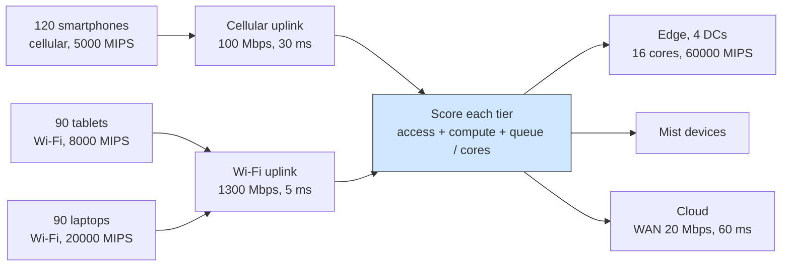

# Multi-access MEC: the radio you talk over shapes the placement

## What it shows

The same task does not cost the same on the same node depending on how it got
there. A cellular smartphone pays 30 ms and a 100 Mbps uplink; a Wi-Fi tablet
pays 5 ms and 1300 Mbps. `AccessAwareOrchestrator` folds that difference into
the decision: it scores every allowed candidate as an estimated delay, and the
lowest score wins.

For a candidate node the score is the compute delay on that node, plus the access
delay of the link the task came in on, plus a queue term. The access delay is
the uplink transfer of the device's own technology (cellular or Wi-Fi), and a
cloud candidate pays the WAN hop on top of it. The compute delay is the task
length divided by the node's MIPS per core. The queue term charges one waiting
task for its share of the node's cores, so a busy edge server looks slower than
an idle one. The access technology enters only through that first term, but it
is enough to move a decision: a cellular device whose slow uplink dominates can
find it cheaper to hand the task to a nearby fast laptop on the direct Wi-Fi
link, while a Wi-Fi device, whose uplink to the edge is already fast, keeps the
edge.



## The scenario

`settings/` sets up a multi-access cell:

- four edge data centers at the corners of a 2000 by 2000 meters map, each 16
  cores at 60000 MIPS, linked in a ring over the MAN, with a 1200 meters
  coverage;
- 300 devices, all thin clients that both generate and execute: 40 percent
  cellular smartphones (8 cores at 5000 MIPS, mobile), 30 percent Wi-Fi tablets
  (8 cores at 8000 MIPS) and 30 percent mains-powered Wi-Fi laptops (8 cores at
  20000 MIPS);
- the `ALL` architecture and the `ACCESS_AWARE` algorithm, ten simulated minutes,
  seed 42, decisions made on the device (`enable_orchestrators=false`), no
  registry, a 20 meters device-to-device range;
- a 20 Mbps WAN with 60 ms latency and a 100 Mbps cellular uplink with 30 ms,
  against 1300 Mbps and 5 ms for Wi-Fi;
- the three default applications, Health (20 percent), Augmented reality (30
  percent) and HEAVY_COMP_APP (50 percent).

## Run it

From the repository root, after `pip install -e .`:

```bash
python examples/multi_access_mec/multi_access_mec.py
```

No-install variant:

```bash
PYTHONPATH=src python examples/multi_access_mec/multi_access_mec.py
```

## What to look for

The console ends with the per-technology placements and the result row:

```text
AccessAwareOrchestrator - placements by access technology and tier: cellular/edge=16512, cellular/mist=511, wifi/edge=18591, wifi/mist=39
ACCESS_AWARE     devices= 300 tasks= 43500 ok=  6862 failed(delay)=36638 avg_delay=0.1381   cloud=   0 edge=39649 mist=3851 wan_usage=88.616    energy=177.045
```

| Access technology | Placements on the edge | Placements on the mist |
| --- | --- | --- |
| cellular | 16512 | 511 |
| Wi-Fi | 18591 | 39 |

- Both technologies overwhelmingly choose the edge, so the tier balance, 39649
  tasks on the edge against 3851 on the mist, is dominated by edge data centers
  being fast and Wi-Fi devices being within reach. No task runs on the cloud,
  because the 20 Mbps plus 60 ms WAN term is added to every cloud estimate and
  keeps it above the edge and mist alternatives.
- The access-aware distinction lives in the mist column. Cellular devices reach
  the mist 511 times out of 17023 placements, about 3.0 percent, while Wi-Fi
  devices do it only 39 times out of 18630, about 0.21 percent. A slow cellular
  uplink inflates the edge estimate, so a nearby fast laptop on the direct Wi-Fi
  link wins, an outcome the Wi-Fi devices rarely see.
- The cellular traffic dominates the radio bill even though it is only 40 percent
  of the devices: 237.5002 Wh of LTE network energy against 14.2998 Wh of Wi-Fi,
  which is what the 100 Mbps and 30 ms link costs to push the same bytes. The
  compute energy, 104.8852 Wh mist and 72.1598 Wh edge, sums to the 177.045 Wh
  reported for computing nodes.
- The cost side is the same load pressure the other fog examples show. The fleet
  generates 43500 requests and only 6862 succeed, 15.77 percent, with 36638
  missing their latency budget, because 300 busy devices saturate the four edge
  servers; the average compute time stays low at 0.1381 s and the average request
  makespan at 1.3417 s.

Set `cellular_bandwidth` to 10 to widen the gap: cellular tasks pay ten times the
uplink transfer, more of them fall to a mist node, and the delay-failure count
rises while the Wi-Fi tasks are untouched.

Results go to `examples/multi_access_mec/output/`.

## Files

- `multi_access_mec.py` with `AccessAwareOrchestrator` and the single run
- `settings/` with `simulation_parameters.properties`, `applications.xml`, the
  three access device types in `edge_devices.xml`, `edge_datacenters.xml` and
  `cloud.xml`

## Where to go next

- [Fog layers](../fog_layers/README.md) for a placement that walks a fixed layer
  order instead of scoring each tier
- [Q-learning](../q_learning/README.md) for a tier choice learned from delay
  rather than estimated from the link
