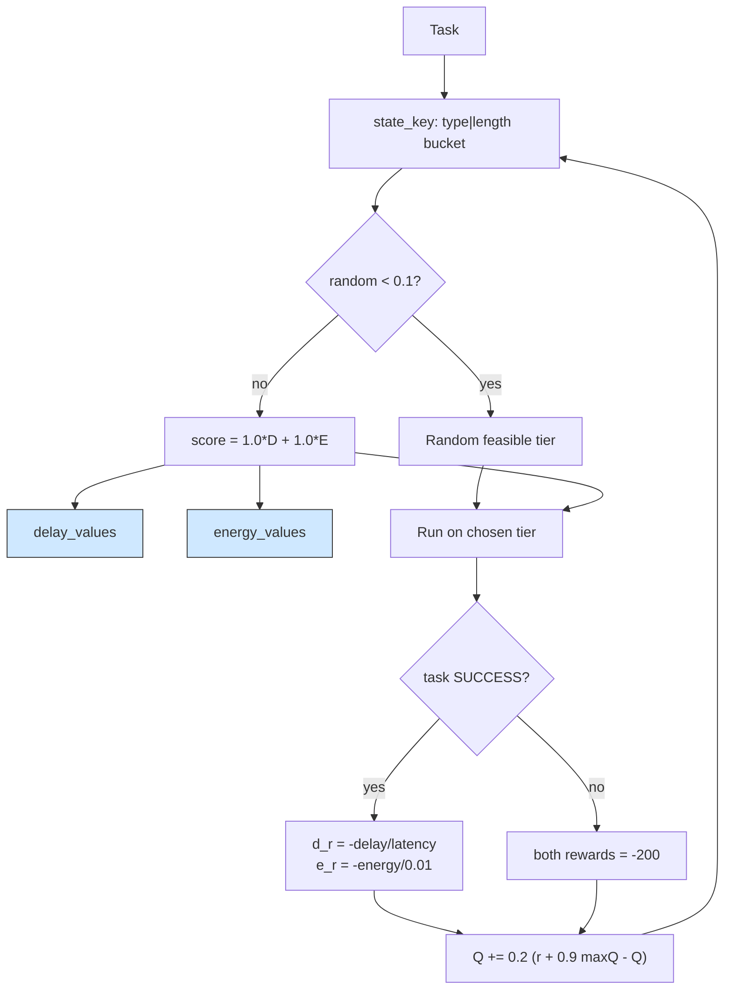

# Multi-objective RL: two value tables, one weighted decision

## What it shows

Delay and energy are different currencies, so learning them together in one table
blurs them. `MultiObjectiveOrchestrator` keeps two tables, `delay_values` and
`energy_values`, indexed by the same state (the application type and a task-length
bucket, `state_key` = `type|bucket` with buckets at 1000, 5000 and 20000 MI) and
by one action per tier the architecture allows. Each table is updated with the
textbook rule `Q += 0.2 * (reward + 0.9 * max Q(next) - Q)` (`LEARNING_RATE` =
0.2, `DISCOUNT_RATE` = 0.9, `EPSILON` = 0.1). The delay reward is
`-total_delay / max_latency` and the energy reward is the negative estimated
energy divided by `REFERENCE_ENERGY_WH` = 0.01, so 0.01 Wh maps to a reward of -1;
a failed task applies `-FAILURE_PENALTY` = -200 to both tables. Keeping the
objectives in separate tables means the trade-off is a decision-time parameter,
not a retraining: `find_computing_node` scores each action as
`DELAY_WEIGHT * delay_value + ENERGY_WEIGHT * energy_value`, both set to 1.0 here.



## The scenario

`settings/` runs one scenario, once, on a fixed seed, on the same topology as the
ant colony and priority examples:

- 300 devices on a 2000 by 2000 meters map, `ALL` architecture and the
  `SCALARIZED_Q` algorithm, `random_seed` = 53, five simulated minutes, decisions
  made on the device (`enable_orchestrators` = false);
- a fleet of five device types, two of which are sensors with no computing power;
- four edge data centers of 10 cores at 40000 MIPS, a cloud of 200 cores, and the
  shared 20 Mbps WAN at 0.06 s latency;
- the same three applications: Health (Hard Real-time, 500 MI, 0.02 s), Augmented
  reality (Soft Real-time, 5000 MI, 0.5 s) and HEAVY_COMP_APP (Non Real-time,
  30000 MI, 300 s).

## Run it

From the repository root, after `pip install -e .`:

```bash
python examples/multi_objective/multi_objective.py
```

No-install variant:

```bash
PYTHONPATH=src python examples/multi_objective/multi_objective.py
```

## What to look for

```text
SCALARIZED_Q             devices= 300 tasks= 16870 ok= 12367 avg_delay=0.185    cloud= 1870 edge=10994 mist= 4006 energy=73.2994
```

- The energy table was meant to drag this run toward the cloud, but on the
  corrected network it does not. The cloud still has 200 cores and the lowest
  estimated compute energy, yet with `ENERGY_WEIGHT` = 1.0 no heavier than the
  delay term the agent ships only 1870 tasks to the cloud, now the fewest of the
  three learning policies on this scenario (softmax 2736, ant colony 2113), while
  the edge carries the bulk (10994 placements).
- The cloud is still the weak tier: only 135 of those 1870 tasks succeed (7.2%),
  because every cloud placement pays a WAN transfer on the 20 Mbps uplink. With
  the corrected model that transfer is no longer over-counted, so the shared WAN
  logs just 179.67 s here, below the 649.92 s of the ant colony run, and the delay
  table keeps the bulk of the traffic at the edge instead of letting the energy
  table overrule it.
- The promised energy saving now shows up. Total energy is 73.30 Wh, the second
  lowest of the four policies on the same scenario, just above the priority rule
  (72.60) and well below the softmax run (76.51) and the ant colony (77.67),
  because the corrected model no longer charges a failed WAN transfer twice and
  the load sits on the efficient edge. The per-tier split favors the edge and
  mist for wins: 9292 of 10994 edge tasks (84.5%) and 2940 of 4006 mist tasks
  (73.4%) succeed.
- Average delay, 0.185 s, is now the highest of the four policies, behind the ant
  colony's 0.1666 and the softmax run's 0.1704, while the success count, 12367,
  is the best of the four, just ahead of the ant colony (12352), the softmax run
  (12306) and the priority rule (12279). Results go to
  `examples/multi_objective/output/`.

This is a policy to tune rather than trust at the default weights: set
`ENERGY_WEIGHT` to 0.1 (or drop `REFERENCE_ENERGY_WH`) to let the delay table
dominate and watch the cloud placements collapse.

## Files

- `multi_objective.py` with `MultiObjectiveOrchestrator`
- `settings/` with `simulation_parameters.properties`, `applications.xml`,
  `edge_devices.xml`, `edge_datacenters.xml` and `cloud.xml`

## Where to go next

- [Q-learning](../q_learning/README.md) for the single delay-only table this
  example doubles into two objectives
- [Ant colony](../ant_colony/README.md) for a sampled policy on the same scenario
- [Output and metrics](../../docs/output-and-metrics.md) for how energy and WAN
  usage are accounted per tier
- [Custom policies](../../README.md#custom-policies) in the main README
