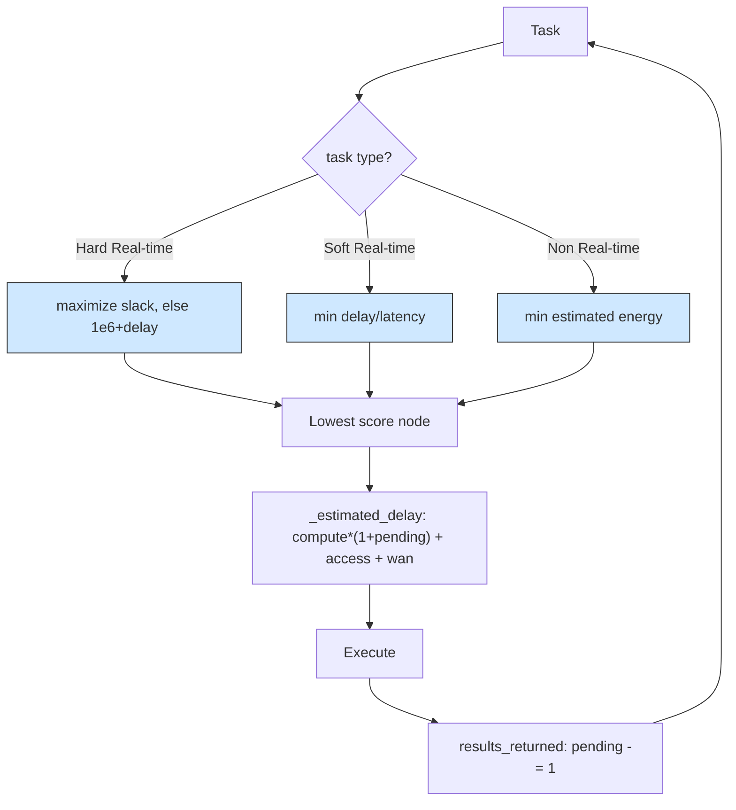

# Priority placement: one orchestrator, three task classes, three objectives

## What it shows

Not every workload should be optimized the same way, so this orchestrator picks
its objective from the application type instead of learning one. In
`find_computing_node` each eligible node is scored by a rule chosen for the task
class. A Hard Real-time task maximizes the latency margin: with
`slack = max_latency - estimated_delay` the score is `-slack` when the node can
meet the deadline, and `DEADLINE_MISS_PENALTY` (1e6) plus the delay when it
cannot, so a feasible node always wins and only an infeasible situation falls
back to the fastest node. A Soft Real-time task minimizes the normalized delay,
`estimated_delay / max_latency`. A Non Real-time task minimizes the estimated
energy, `max_consumption * compute_time / 3600`, with a tiny `delay * 1e-9`
tiebreaker. The estimate in `_estimated_delay` covers the compute time scaled by
the tasks already pending on the node, the device access latency, and the WAN
latency when the destination is the cloud. `results_returned` only decrements the
pending count, so this policy adapts to load in the moment rather than learning
across tasks.



## The scenario

`settings/` runs one scenario, once, on a fixed seed, on the same topology as the
ant colony and multi-objective examples:

- 300 devices on a 2000 by 2000 meters map, `ALL` architecture and the
  `PRIORITY_AWARE` algorithm, `random_seed` = 41, five simulated minutes,
  decisions made on the device (`enable_orchestrators` = false);
- a fleet of five device types, two of which are sensors with no computing power;
- four edge data centers of 10 cores at 40000 MIPS, a cloud of 200 cores, and the
  shared 20 Mbps WAN at 0.06 s latency;
- the three applications that make the three rules meaningful: Health (Hard
  Real-time, 500 MI, 0.02 s bound), Augmented reality (Soft Real-time, 5000 MI,
  0.5 s bound) and HEAVY_COMP_APP (Non Real-time, 30000 MI, 300 s bound).

## Run it

From the repository root, after `pip install -e .`:

```bash
python examples/priority_placement/priority_placement.py
```

No-install variant:

```bash
PYTHONPATH=src python examples/priority_placement/priority_placement.py
```

## What to look for

```text
PRIORITY_AWARE  devices= 300 tasks= 16870 ok= 4770 avg_delay=0.1859 cloud=5891 edge=5900 mist=5079 energy=76.5246
```

- This rule-based policy posts the best success count of the four adaptive
  examples, 4770 of 16870 tasks (28%), and the lowest total energy, 76.52 Wh. The
  latency-sensitive classes land where they can clear their budget: 3405 of 5079
  mist tasks (67%) and 1365 of 5900 edge tasks (23%) succeed, which is what the
  slack rule and the normalized-delay rule are designed to do.
- The striking result is the cloud: 5891 tasks were placed there and 0 of them
  succeeded. The non real-time energy rule treats the 200-core cloud as the
  cheapest destination (its compute time, and so its estimated active energy, is
  tiny), so it loads the cloud with the 30000 MI HEAVY jobs, but every one of
  them misses its 300 s bound on the congested shared WAN (77083 s of WAN usage
  this run). The estimate optimizes compute energy and never sees the transfer
  cost it actually pays.
- So the policy wins the two metrics you would judge it on, success rate and
  energy, while quietly wasting an entire tier. Its average delay, 0.1859 s, is
  also slightly worse than the ant colony's 0.1776, and that is expected: delay
  is not this policy's objective for the bulk of the traffic. Results go to
  `examples/priority_placement/output/`.

Give the non real-time rule a transfer-aware estimate, or restrict the cloud
placement, to stop the 0-of-5891 outcome.

## Files

- `priority_placement.py` with `PriorityOrchestrator`
- `settings/` with `simulation_parameters.properties`, `applications.xml`,
  `edge_devices.xml`, `edge_datacenters.xml` and `cloud.xml`

## Where to go next

- [Ant colony](../ant_colony/README.md) for a learning policy on the same
  scenario that also struggles with cloud placements
- [Multi-objective](../multi_objective/README.md) for a learned delay-versus-
  energy trade-off against this hand-set one
- [Writing orchestrators](../../docs/orchestrators.md) for `find_computing_node`
  and the per-task scoring this example shows
- [Output and metrics](../../docs/output-and-metrics.md) for the per-tier success
  and energy columns
