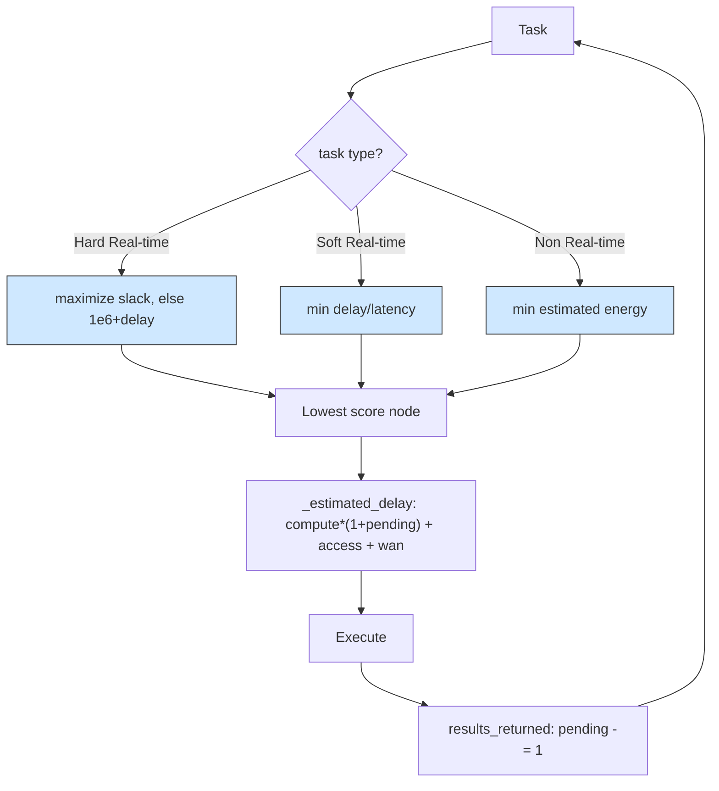

# Priority placement: one orchestrator, three task classes, three objectives

## What it shows

Not every workload should be optimized the same way, so this orchestrator picks
its objective from the application type instead of learning one. In
`find_computing_node` each eligible node is scored by a rule chosen for the task
class. A Hard Real-time task maximizes the latency margin: with
`slack = max_latency - estimated_delay` the score is `-slack` when the node can
meet the deadline, and `DEADLINE_MISS_PENALTY` (1e6) plus the delay when it
cannot, so a feasible node always wins and only an infeasible situation falls
back to the fastest node. A Soft Real-time task minimizes the normalized delay,
`estimated_delay / max_latency`. A Non Real-time task minimizes the estimated
energy, `max_consumption * compute_time / 3600`, with a tiny `delay * 1e-9`
tiebreaker. The estimate in `_estimated_delay` covers the compute time scaled by
the tasks already pending on the node, the device access latency, and the WAN
latency when the destination is the cloud. `results_returned` only decrements the
pending count, so this policy adapts to load in the moment rather than learning
across tasks.



## The scenario

`settings/` runs one scenario, once, on a fixed seed, on the same topology as the
ant colony and multi-objective examples:

- 300 devices on a 2000 by 2000 meters map, `ALL` architecture and the
  `PRIORITY_AWARE` algorithm, `random_seed` = 41, five simulated minutes,
  decisions made on the device (`enable_orchestrators` = false);
- a fleet of five device types, two of which are sensors with no computing power;
- four edge data centers of 10 cores at 40000 MIPS, a cloud of 200 cores, and the
  shared 20 Mbps WAN at 0.06 s latency;
- the three applications that make the three rules meaningful: Health (Hard
  Real-time, 500 MI, 0.02 s bound), Augmented reality (Soft Real-time, 5000 MI,
  0.5 s bound) and HEAVY_COMP_APP (Non Real-time, 30000 MI, 300 s bound).

## Run it

From the repository root, after `pip install -e .`:

```bash
python examples/priority_placement/priority_placement.py
```

No-install variant:

```bash
PYTHONPATH=src python examples/priority_placement/priority_placement.py
```

## What to look for

```text
PRIORITY_AWARE           devices= 300 tasks= 16870 ok= 12279 avg_delay=0.1809   cloud=   23 edge=13370 mist= 3477 energy=72.5979
```

- This rule-based policy posts the lowest total energy of the four adaptive
  examples, 72.60 Wh, but now the fewest successes, 12279 of 16870 tasks, just
  behind the multi-objective agent (12367), the ant colony (12352) and the softmax
  run (12306). The latency-sensitive classes land where they can clear their
  budget: 2837 of 3477 mist tasks (81.6%, the highest tier) and 9442 of 13370 edge
  tasks (70.6%) succeed, which is what the slack rule and the normalized-delay
  rule are designed to do.
- The cloud is now almost untouched: only 23 tasks were placed there and none
  succeeded. The non real-time energy rule still treats the 200-core cloud as the
  cheapest destination on paper (its compute time, and so its estimated active
  energy, is tiny), but the bulk of the 30000 MI HEAVY jobs now stay on the edge
  (13370 placements), so the shared WAN sees just 14.26 s of traffic this run
  instead of the cloud-filling transfer the old numbers showed.
- So the policy wins on energy but not on successes: it is the cheapest of the
  four yet clears the fewest tasks, and with the corrected model it no longer
  wastes the cloud tier, it simply leaves it idle. Its average delay, 0.1809 s, is
  worse than the ant colony's 0.1666, and that is expected: delay is not this
  policy's objective for the bulk of the traffic. Results go to
  `examples/priority_placement/output/`.

Give the non real-time rule a transfer-aware estimate, or restrict the cloud
placement, to stop the 0-of-23 outcome.

## Files

- `priority_placement.py` with `PriorityOrchestrator`
- `settings/` with `simulation_parameters.properties`, `applications.xml`,
  `edge_devices.xml`, `edge_datacenters.xml` and `cloud.xml`

## Where to go next

- [Ant colony](../ant_colony/README.md) for a learning policy on the same
  scenario that also struggles with cloud placements
- [Multi-objective](../multi_objective/README.md) for a learned delay-versus-
  energy trade-off against this hand-set one
- [Writing orchestrators](../../docs/orchestrators.md) for `find_computing_node`
  and the per-task scoring this example shows
- [Output and metrics](../../docs/output-and-metrics.md) for the per-tier success
  and energy columns
