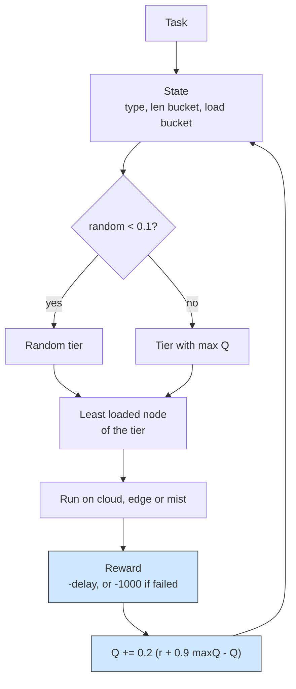

# Q-learning: learning which tier should run each task

## What it shows

Placement here is not hand-written, it is discovered. `QLearningOrchestrator`
turns the tier choice into a reinforcement problem: a state is the application
type, a coarse bucket of the task length (`LENGTH_BUCKETS` = 1000, 5000, 20000
MI) and a bucket of the pending load of the tier, and an action is one of the
tiers the `ALL` architecture allows, in the order cloud, edge, mist. Open
`choose_action` for the epsilon-greedy rule (one decision in ten explores,
`EXPLORATION_RATE` = 0.1, otherwise the tier with the largest value wins) and
`observe`, called from `results_returned`, which books the reward and applies the
textbook update `Q += 0.2 * (reward + 0.9 * max Q(next) - Q)`. The reward is the
negated total delay, or a penalty of -1000 when the task fails. This module is
the shared home of the agent: the mist-only and edge-orchestrated examples import
this class and only change the scenario, and the softmax example derives its
Boltzmann policy from it.



## The scenario

`settings/` runs one scenario, twice, on the same seed, so the only difference is
the policy:

- 100 devices on a 200 by 200 meters map, with a 10 meters device-to-device range;
- the `ALL` architecture and the `Q_LEARNING` algorithm, `random_seed` = 42, five
  simulated minutes, decisions made on the device (`enable_orchestrators` = false);
- one edge data center of 10 cores at 40000 MIPS, a cloud of 200 cores, and a
  fleet of five device types, two of which are sensors without computing power;
- three applications keep the state meaningful: Health (Hard Real-time, 20%,
  500 MI), Augmented reality (Soft Real-time, 30%, 5000 MI) and HEAVY_COMP_APP
  (Non Real-time, 50%, 30000 MI).

The first run uses `DefaultOrchestrator` with `TRADE_OFF`, the second the learned
policy.

## Run it

From the repository root, after `pip install -e .`:

```bash
python examples/q_learning/q_learning.py
```

No-install variant:

```bash
PYTHONPATH=src python examples/q_learning/q_learning.py
```

## What to look for

```text
TRADE_OFF   tasks= 5550 ok= 1190 avg_delay=0.2092 cloud=1410 edge=1575 mist=2565 energy=23.7768
Q_LEARNING  tasks= 5550 ok= 1181 avg_delay=0.1841 cloud=3461 edge=1004 mist=1085 energy=25.2232
```

- The average delay of completed tasks drops to 0.1841 from 0.2092, but the
  success count barely moves and is a little worse (1181 against 1190): the
  learner trades a handful of successes for faster completions, so report it as a
  trade-off rather than a win.
- The CSV explains the shift: Q-learning placed 3461 tasks on the cloud yet only
  150 succeeded there, because 4369 tasks blew their latency budget on the shared
  WAN link. Most real successes came from the mist (671 of 1085) and the edge
  (360 of 1004), so the value table drives tasks to the tier that drains fastest.
- Energy rises to 25.22 Wh, and the per-level split (mist 11.70, edge 10.14,
  cloud 3.38) shows the cost sits in the mobile fleet and the data center idle
  draw, not in the cloud compute.
- Results go to `examples/q_learning/output/`. The settings clear the output
  folder before each launch, so the CSV on disk keeps only the learned row; the
  `TRADE_OFF` line above is printed by the first launch of the same run.

Raise `EXPLORATION_RATE` or lower `LEARNING_RATE` in the class to watch the table
converge differently.

## Files

- `q_learning.py` with `QLearningOrchestrator` and the two comparison runs
- `settings/` with `simulation_parameters.properties`, `applications.xml`,
  `edge_devices.xml`, `edge_datacenters.xml` and `cloud.xml`

## Where to go next

- [Softmax orchestrator](../softmax_orchestrator/README.md) for the same table
  sampled from a Boltzmann distribution instead of epsilon-greedy
- [Mist-only Q-learning](../mist_only_q_learning/README.md) for this agent with
  the cloud and edge actions removed
- [Custom policies](../../README.md#custom-policies) in the main README
