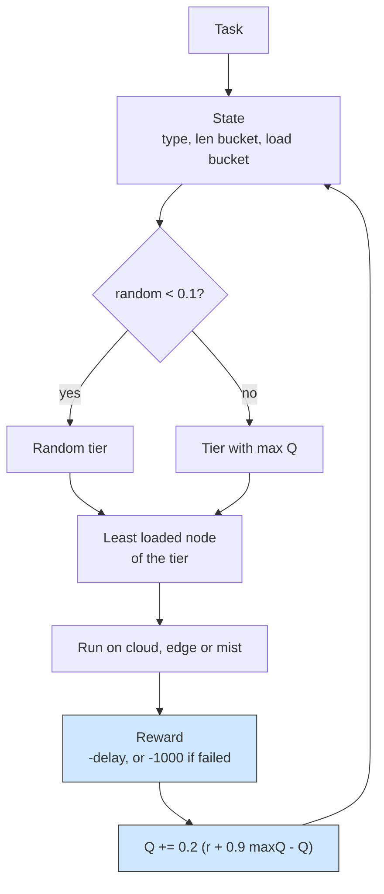

# Q-learning: learning which tier should run each task

## What it shows

Placement here is not hand-written, it is discovered. `QLearningOrchestrator`
turns the tier choice into a reinforcement problem: a state is the application
type, a coarse bucket of the task length (`LENGTH_BUCKETS` = 1000, 5000, 20000
MI) and a bucket of the pending load of the tier, and an action is one of the
tiers the `ALL` architecture allows, in the order cloud, edge, mist. Open
`choose_action` for the epsilon-greedy rule (one decision in ten explores,
`EXPLORATION_RATE` = 0.1, otherwise the tier with the largest value wins) and
`observe`, called from `results_returned`, which books the reward and applies the
textbook update `Q += 0.2 * (reward + 0.9 * max Q(next) - Q)`. The reward is the
negated total delay, or a penalty of -1000 when the task fails. This module is
the shared home of the agent: the mist-only and edge-orchestrated examples import
this class and only change the scenario, and the softmax example derives its
Boltzmann policy from it.



## The scenario

`settings/` runs one scenario, twice, on the same seed, so the only difference is
the policy:

- 100 devices on a 200 by 200 meters map, with a 10 meters device-to-device range;
- the `ALL` architecture and the `Q_LEARNING` algorithm, `random_seed` = 42, five
  simulated minutes, decisions made on the device (`enable_orchestrators` = false);
- one edge data center of 10 cores at 40000 MIPS, a cloud of 200 cores, and a
  fleet of five device types, two of which are sensors without computing power;
- three applications keep the state meaningful: Health (Hard Real-time, 20%,
  500 MI), Augmented reality (Soft Real-time, 30%, 5000 MI) and HEAVY_COMP_APP
  (Non Real-time, 50%, 30000 MI).

The first run uses `DefaultOrchestrator` with `TRADE_OFF`, the second the learned
policy.

## Run it

From the repository root, after `pip install -e .`:

```bash
python examples/q_learning/q_learning.py
```

No-install variant:

```bash
PYTHONPATH=src python examples/q_learning/q_learning.py
```

## What to look for

```text
orchestration strategy, same seed and same workload:
TRADE_OFF                tasks=  5550 ok=  4173 avg_delay=0.1997   cloud=  467 edge= 2656 mist= 2427 failed(delay)= 1377 failed(mobility)=   0 energy=23.3791
Q_LEARNING               tasks=  5550 ok=  4128 avg_delay=0.1742   cloud=  859 edge= 3263 mist= 1428 failed(delay)= 1422 failed(mobility)=   0 energy=24.0632
```

- The average delay of completed tasks drops to 0.1742 from 0.1997, while the
  success count barely moves and is a little worse (4128 against 4173): the
  learner trades 45 successes for faster completions, so report it as a trade-off
  rather than a win.
- The CSV explains the shift: the learned table sends most work to the edge tier,
  3263 tasks, against 1428 in the mist and 859 on the cloud. The edge and the mist
  are where it pays, 2771 successes at the edge (84.9%) and 1237 in the mist (86.6%);
  the cloud is the one placement the learner still gets wrong, only 120 of its 859
  tasks finish inside the budget (14.0%). The 1422 delay failures split as 739 in
  the cloud, 492 at the edge and 191 in the mist, so the value table drives tasks to
  the tier with the biggest CPU pool and the shortest hop, not to the tier that
  drains the battery fastest: nothing is lost to a dead device and the fleet still
  holds 99.71% of its charge after the five simulated minutes.
- Energy rises to 24.06 Wh against 23.38 Wh for the same workload under
  `TRADE_OFF`, and the per-tier split (mist 11.96, edge 11.31, cloud 0.80) shows
  the cost sits in the mobile fleet and in the edge data center that serves it,
  not in the cloud compute; the network columns point the same way, 4.12 Wh on the
  LAN against 0.27 Wh on the WAN.
- Results go to `examples/q_learning/output/`. The settings clear the output
  folder before each launch, so the CSV on disk keeps only the learned row; the
  `TRADE_OFF` line above is printed by the first launch of the same run.

Raise `EXPLORATION_RATE` or lower `LEARNING_RATE` in the class to watch the table
converge differently.

## Files

- `q_learning.py` with `QLearningOrchestrator` and the two comparison runs
- `settings/` with `simulation_parameters.properties`, `applications.xml`,
  `edge_devices.xml`, `edge_datacenters.xml` and `cloud.xml`

## Where to go next

- [Softmax orchestrator](../softmax_orchestrator/README.md) for the same table
  sampled from a Boltzmann distribution instead of epsilon-greedy
- [Mist-only Q-learning](../mist_only_q_learning/README.md) for this agent with
  the cloud and edge actions removed
- [Custom policies](../../README.md#custom-policies) in the main README
