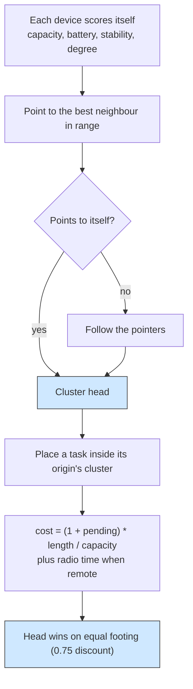

# Self clustering: an elected head per neighbourhood

## What it shows

There is no central cluster manager here. Each device scores itself from four
local signals, points to the best neighbour it can reach, and the clusters
emerge from those pointers: a device that points to itself is a head, and every
other device follows the pointers until it reaches one. The orchestrator then
places a task inside the cluster its origin joined, giving the elected head a
25 percent discount so a neighbourhood gets a natural centre of gravity without
any negotiation or message exchange.

The Python core has no hook for a custom computing node, so the election state
does not live on the devices the way it does in the Java port. It lives in
`ClusterOrchestrator`, registered as a simulation entity, which runs one
clustering round every `CLUSTER_UPDATE_INTERVAL` of 30 seconds (the first at one
second) rather than letting a coordinator device drive it. The scoring and the
pointer-following stay module-level pure functions, `elect_clusters` and
`refresh_clusters`, which is the counterpart of the two static methods the Java
device class carried.

The score is a weighted sum of normalised signals: capacity (0.4, total MIPS over
the most powerful alive device), battery (0.25, remaining level, or 1.0 for a
mains device), stability (0.2, 1.0 for a fixed device, falling to 0 at 10 m/s),
and neighbourhood (0.15, devices in range, saturating at 10). A device points to
the best score among its reachable neighbours and itself, ties going to the
lower identifier. Dead devices and sensors are left out.



## The scenario

`settings/` starts from a mist-only fleet:

- 200 devices on a 500 by 500 meters map with a 100 meters device-to-device
  range, seed 71, five simulated minutes;
- all three device types both generate and execute, so every task can stay in
  the device layer, and there are no sensors (a sensor would have nowhere to run
  under `MIST_ONLY`): 40 percent mobile smartphones (8 cores at 10000 MIPS,
  battery, 1.4 m/s), 30 percent tablets (8 cores at 20000 MIPS, battery) and 30
  percent mains-powered laptops (8 cores at 50000 MIPS);
- the `MIST_ONLY` architecture and the `CLUSTER_LOCAL` algorithm, with
  orchestrators disabled so each device consults its own cluster without an
  extra network hop;
- the three default applications, Health (20 percent, 20 ms), Augmented reality
  (30 percent, 0.5 s) and HEAVY_COMP_APP (50 percent, non real-time).

The one edge data center in `edge_datacenters.xml` is never a destination under
this architecture, so its idle draw is the only edge energy in the report.

## Run it

From the repository root, after `pip install -e .`:

```bash
python examples/self_clustering/self_clustering.py
```

No-install variant:

```bash
PYTHONPATH=src python examples/self_clustering/self_clustering.py
```

## What to look for

The console ends with the two cluster reports and the result row:

```text
ClusterOrchestrator - cluster placement: 3431 placements, head=34.1 %, member=1.5 %, local=64.3 %, outside=0.0 %
ClusterOrchestrator - clustering: 11 clusters over 200 devices, 11 rounds, average size 18.2, largest 38
CLUSTER_LOCAL    devices= 200 tasks= 14500 ok= 11200 failed(delay)= 3300 avg_delay=0.1306   cloud=   0 edge=   0 mist=14500 lan_usage=83.6353   traffic_MB=13264.28  energy=45.1434
```

| Placement kind | Share of the 3431 decisions |
| --- | --- |
| head | 34.1 % |
| member | 1.5 % |
| local (the origin) | 64.3 % |
| outside the cluster | 0.0 % |

- The election groups the map the way a 100 meter range on a 500 by 500 meter
  field should: 11 clusters over 200 devices, an average size of 18.2 and a
  largest of 38, re-run 11 times over the five minutes (a round every 30 seconds
  plus the opening one).
- The clustering is sound: 0.0 percent of placements fall outside the origin's
  cluster, so every task found a host among the head, its members, or the origin
  itself. A placement is an orchestration decision, so once an application lands
  on a device its later tasks reuse that host, which is why 3431 decisions cover
  the 14500 generated tasks, all of them executed on the mist (cloud and edge
  both zero).
- The origin now keeps most of the work: 64.3 percent of placements stay on the
  device that generated the task, the elected head takes 34.1 percent, and only
  1.5 percent go to the other members. The 25 percent discount makes the head the
  strong second rather than the majority, because once a device has hosted an
  application its later tasks reuse it, so the origin's count grows fastest of all.
  The discount still bites where the cost is close: at equal capacity the head
  wins, and the cost function charges radio time for a remote host, so a
  latency-sensitive Health task, with only 20 ms to spend against 5 ms of Wi-Fi,
  is kept local by its origin.
- Even without an edge to escape to, the mist fleet now clears most of its work:
  11200 of 14500 tasks succeed, 77.24 percent, and 3300 miss their latency budget;
  the average compute time is 0.1306 s and the average request makespan 0.1694 s.
  Transfers finishing at their exact completion time, rather than the next
  one-second poll, lift a `MIST_ONLY` run that once looked hopeless. The residual
  3300 failures are the hot clusters with nowhere to overflow, the case the head
  discount is meant to soften.
- Self-organisation is also cheap on energy: 45.1434 Wh in total, 36.2823 Wh of it
  from the mist devices, with 0 dead devices and 99.34 percent average remaining
  battery after five minutes. The 8.8611 Wh ascribed to the edge is the idle draw
  of the one data center that `MIST_ONLY` never routes to.

Set `HEAD_COST_FACTOR` to 1.0 to drop the discount and watch the head share
fall, or change `CLUSTER_UPDATE_INTERVAL` to see how stale membership and
placement react as mobility moves the neighbourhoods between rounds.

Results go to `examples/self_clustering/output/`.

## Files

- `self_clustering.py` with `ClusterOrchestrator`, the `elect_clusters` and
  `refresh_clusters` functions, and the single run
- `settings/` with `simulation_parameters.properties`, `applications.xml`, the
  three executing device types in `edge_devices.xml`, `edge_datacenters.xml` and
  `cloud.xml`

## Where to go next

- [Fog layers](../fog_layers/README.md) for a hierarchy fixed by physical layer
  rather than elected per round
- [Multi-access MEC](../multi_access_mec/README.md) for a placement that scores
  every tier instead of restricting to one cluster
