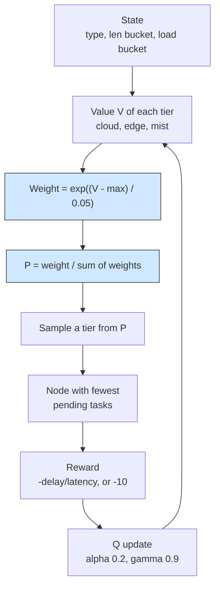

# Softmax orchestrator: Boltzmann exploration of the tiers

## What it shows

Same learned table of tier values as the Q-learning example, but a different way
to act on it. `SoftmaxOrchestrator` subclasses `QLearningOrchestrator` and keeps
only the state (application type, task-length bucket, layer-load bucket) and the
update rule; it replaces epsilon-greedy with sampling. Open `boltzmann_weights`
and `probabilities`: each reachable tier weighs `exp((value - max) / TEMPERATURE)`
with `TEMPERATURE` = 0.05, and the tier is drawn from that distribution. Better
tiers win more often, and as the values separate exploration fades on its own, so
there is no exploration rate to tune. Two more overrides change the shape of the
result: `reward` divides the delay by the task latency bound (failure penalty
drops from -1000 to -10, so a state value means the same thing whatever the task
size), and `node_in_tier` picks the node with the fewest tasks still in flight.



## The scenario

`settings/` describes the city-scale version of the Q-learning workload, run once
with the learned policy:

- 300 devices on a 2000 by 2000 meters map, with a 20 meters device-to-device
  range;
- the `ALL` architecture and the `SOFTMAX` algorithm, `random_seed` = 11, five
  simulated minutes, decisions made on the device (`enable_orchestrators` =
  false, so `deploy_orchestrator` = EDGE is not used);
- four edge data centers of 10 cores at 40000 MIPS and a cloud of 200 cores;
- the same three applications as the Q-learning example (Hard, Soft and Non
  Real-time at 20, 30 and 50 percent).

## Run it

From the repository root, after `pip install -e .`:

```bash
python examples/softmax_orchestrator/softmax_orchestrator.py
```

No-install variant:

```bash
PYTHONPATH=src python examples/softmax_orchestrator/softmax_orchestrator.py
```

## What to look for

```text
softmax  tasks= 16870 ok= 3268 avg_delay=0.1756 cloud=7718 edge=6847 mist=2305 energy=79.4645
```

- The average delay of completed tasks, 0.1756 s, is the lowest of the four
  policies measured on this scenario (ant colony 0.1776, multi-objective 0.1835,
  priority 0.1859), but only 3268 of 16870 tasks succeed (13602 fail on delay):
  the sampler keeps probing the congested cloud, so the successes are the quick
  ones.
- The CSV shows where they land. Mist completes 1768 of 2305 placements, edge
  1215 of 6847, and cloud only 285 of 7718, so a low `TEMPERATURE` makes the
  high-value mist and edge tiers win most draws while the cloud still absorbs the
  overflow. This relative success rate, not the raw cloud count, is what the
  Boltzmann sampling is buying.
- Energy reaches 79.46 Wh and splits across the levels (edge 37.36, mist 34.87,
  cloud 7.23): four data centers carrying tasks cost more than the single data
  center of the Q-learning example.
- Results go to `examples/softmax_orchestrator/output/`.

Set `TEMPERATURE` higher to flatten the distribution and see exploration return,
or lower it to make the policy nearly greedy.

## Files

- `softmax_orchestrator.py` with `SoftmaxOrchestrator`
- `../q_learning/q_learning.py` for the base agent it extends
- `settings/` with `simulation_parameters.properties`, `applications.xml`,
  `edge_devices.xml`, `edge_datacenters.xml` and `cloud.xml`

## Where to go next

- [Q-learning](../q_learning/README.md) for the epsilon-greedy policy this class
  replaces
- [Edge-orchestrated Q-learning](../edge_orchestrated_q_learning/README.md) for
  the same tier choice decided on an edge data center instead of the device
