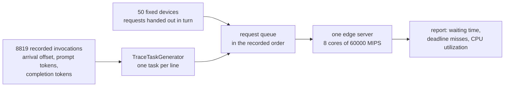

# Trace replay: feeding the simulator a recorded production workload

## What it shows

How to replace the random arrival process with measured traffic. The workload is
a real trace, `trace/azure_llm_code_1h.csv`: 8819 invocations of an LLM inference
service running in production, each one recorded with the instant it arrived, how
many tokens it read and how many it produced. It is the code completion sample of
the Azure LLM inference dataset released with the Splitwise paper;
`trace/NOTICE.md` gives the source, the licence, the citation and the one
transformation applied to the published file.

`TraceTaskGenerator` turns every recorded line into exactly one request. Nothing
is drawn, so the burstiness of real traffic, which is what overloads a server,
reaches the orchestrator untouched. The same file replayed by the Java simulator
(its `Example25`) gives the same 8819 requests in the same order: the two
implementations agree on this scenario request for request, because no random
value is involved on either side.



## The API detail this example exists to show

A task generator returns the whole queue before the first event is scheduled, so
it is free to build its tasks from anything: the distributions of
`applications.xml`, as `DefaultTaskGenerator` does, or a file. The only structure
the rest of the framework requires is that each task carries its generation time,
its sizes, its length and its deadline:

```python
task = Task(
    id=identifier,
    type=application.type,
    application_id=APPLICATION,
    length=context_tokens * mi_per_context_token + generated_tokens * mi_per_generated_token,
    container_size=application.container_size.sample(),
    request_size=round(context_tokens * bytes_per_token * 8),
    result_size=round(generated_tokens * bytes_per_token * 8),
    max_latency=latency,
    time=time,
    source_device=device,
    registry=self.manager.registry,
)
task.set_request(self.request_counter, 1, time, time + latency)
```

The recorded stream describes one service, not one device, so the requests are
handed to the devices in turn: the fleet stays evenly loaded while the
instantaneous arrival rate remains exactly as recorded. Because the generator
draws nothing, the replay is reproducible on its own, whatever `random_seed` says.
The test suite checks that, along with the task count, the arrival times and the
per-device split.

## From tokens to simulator units

A trace names what a request is, not how long it takes on the machine being
simulated, so the mapping is explicit and every constant is a knob that can be
changed on the command line:

| Flag | Default | Meaning |
| --- | --- | --- |
| `--bytes-per-token` | 4 | bytes of text per token, for the up and down traffic |
| `--mi-per-context-token` | 12 | cost of reading the prompt (the prefill phase) |
| `--mi-per-generated-token` | 2000 | cost of producing one completion token (the decode phase) |
| `--ttft-budget` | 2 | seconds promised before the first token comes back |
| `--decode-budget` | 0.1 | seconds promised per completion token |

The two cost constants are a throughput statement rather than a guess: on a
60000 MIPS core, 12 MI per prompt token is 5000 prompt tokens per second, and
2000 MI per completion token is 30 completion tokens per second. The ratio between
the two phases, about 167, is the asymmetry that the paper which published this
trace measures on the serving hardware. The deadline model follows the same logic:
10 completion tokens per second promised to the user, against 30 per second of the
machine, so a request only misses because it waited in a queue, not because the
budget was impossible from the start.

With those values the hour asks for 708,511,688 MI over 3436 s, a mean of
206,203 MIPS against the 480,000 MIPS of the server. The server is sized to the
trace, not the trace to the server.

## The scenario

The files in `settings/` describe:

- 50 fixed devices on a 2000 by 2000 meters map, 40 percent on a cellular access
  and 60 percent on wifi, none mobile and none on a battery, so the only
  variability left in the run is the trace itself;
- one edge data center of 8 cores at 60000 MIPS, and `EDGE_ONLY`, so no request
  escapes to the cloud or to the mist tier;
- 58 simulated minutes, which covers the 3436 s of the recorded hour plus a
  minute for the requests still running when it ends;
- one application declaration whose rate, sizes and length are the means of the
  trace. Those values are used only by the baseline mode below, and they are what
  makes the two runs comparable.

Arrival times are recorded in milliseconds and the simulation clock ticks in whole
seconds, so each replayed request is rounded to its second. That is a limitation of
the framework rather than of the trace: the 8819 requests collapse onto 945 distinct
instants, 99.6 percent of them share their second with at least one other request,
and one second holds 68 of them at the peak. The bursts survive the rounding; their
internal order does not.

## Run it

From the repository root, after `pip install -e .`:

```bash
python examples/trace_replay/trace_replay.py
```

Run the same scenario with the requests drawn at random instead, at the mean rate
and mean sizes of the trace:

```bash
python examples/trace_replay/trace_replay.py --synthetic
```

No-install variant:

```bash
PYTHONPATH=src python examples/trace_replay/trace_replay.py
```

Loosen the promise made to the user, or halve the cost of a completion token:

```bash
PYTHONPATH=src python examples/trace_replay/trace_replay.py --decode-budget=0.5
PYTHONPATH=src python examples/trace_replay/trace_replay.py --mi-per-generated-token=1000
```

Each run takes a few seconds. To replay only part of the hour, pass a shorter
period, for example `PYTHONPATH=src python examples/trace_replay/trace_replay.py 50 600 42`:
the generator drops the requests that arrive after the end of the run and says how
many it dropped, rather than failing.

## What to look for

The console first prints what the replay did, before the first event is executed:

```text
TraceTaskGenerator - Trace replay: 8819 requests scheduled between 1 and 3480 s, 0 dropped because they arrive after the end of the run.
recorded   tasks=  8819 ok=  3180 requests_ok= 3180/8819  compute=11808.5281 s waiting=120213.0921 s avg_wait=13.6311 s avg_makespan=2.9072 s edge_cpu=42.4157 % traffic=73.2235 MB energy=528.9444 Wh
synthetic  tasks=  8916 ok=  8916 requests_ok= 8916/8916  compute=11938.3754 s waiting=231.1222 s avg_wait=0.0259 s avg_makespan=1.3949 s edge_cpu=42.7592 % traffic=72.2998 MB energy=531.463 Wh
```

With seed 42, the two modes give:

| Metric | Recorded trace | Synthetic poisson |
| --- | --- | --- |
| Requests generated | 8819 | 8916 |
| Total compute executed | 11808.53 s | 11938.38 s |
| Average task execution time | 1.339 s | 1.339 s |
| Average edge CPU utilization | 42.42 % | 42.76 % |
| Total time spent waiting | 120213.09 s | 231.12 s |
| Average task waiting time | 13.631 s | 0.026 s |
| Requests that completed successfully | 36.06 % (3180) | 100 % (8916) |
| Average request makespan | 2.907 s | 1.395 s |
| Total traffic | 73.22 MB | 72.30 MB |
| Energy of the run | 528.94 Wh | 531.46 Wh |

The two runs do nearly the same amount of work for the same server: the compute
total differs by 1.1 percent, the mean utilization by a third of a point, the
average task execution time by nothing at all, and the traffic by 1.3 percent. What
differs is when that work arrives. The recorded hour spends 120,213 seconds waiting
in a queue and the synthetic hour spends 231, a factor of 520. The difference is not
a reporting artefact: the average request of the replay waits 13.6 seconds before
its first instruction is executed, while its deadline budget averages 4.79 seconds.
63.94 percent of the requests miss it, and they miss it inside the bursts that a
poisson generator with the same mean never produces.

Two more runs, both replaying the same trace, separate the effect of the deadline
model from the effect of the queue:

| Run | Edge CPU utilization | Average waiting time | Successful requests |
| --- | --- | --- | --- |
| recorded trace, default budget | 42.42 % | 13.631 s | 36.06 % (3180) |
| `--decode-budget=0.5` | 42.42 % | 13.631 s | 57.69 % (5088) |
| `--mi-per-generated-token=1000` | 27.69 % | 4.459 s | 61.72 % (5443) |

Loosening the promise to the user moves the pass mark and leaves the waiting time
untouched, to the last digit: the queue is really 13.6 seconds deep, and whether a
request meets its deadline is decided by where the line is drawn. Cutting the cost
of a completion token in half removes a third of the offered load (11808.53 s of
compute become 7710.26 s, and the mean utilization drops from 42.42 to 27.69
percent), and 38.28 percent of the requests still miss. At 27.69 percent mean
utilization the server is idle most of the hour and overloaded for a few seconds at
a time. A capacity study run on synthetic traffic at the same means would have
concluded that this server has headroom.

The recorded column of both tables is deterministic: the same trace file and the
same fleet give the same numbers on every machine, and the Java simulator reports
the same 8819 requests, the same 3180 successes, the same 11808.53 s of compute,
the same 42.42 percent utilization and the same 73.22 MB of traffic on this
scenario. Two columns are not identical: the total waiting time, 120213.09 s here
against 120201.01 s there, a hundredth of a percent, and the energy of the run,
528.94 Wh against 529.06 Wh, two hundredths.
Results go to `examples/trace_replay/output/`, one folder per run, with the
settings that produced it copied alongside the CSV.

- The numbers above are the measured output of the runs of 2026-10-28, with the
  committed `settings/` and seed 42.

## Files

- `trace_replay.py` with `TraceTaskGenerator`
- `trace/azure_llm_code_1h.csv`, the recorded invocations
- `trace/NOTICE.md`, source, licence, citation and transformation
- `settings/applications.xml` with the means the baseline mode replays

## Where to go next

- [Task lifecycle](../../docs/task-lifecycle.md) for what `generate()` returns,
  and when the whole queue exists
- [Architecture](../../docs/architecture.md) for the `set_custom_task_generator`
  injection point this example uses
- [Output and metrics](../../docs/output-and-metrics.md) for the 56 CSV columns the
  two summary lines are drawn from
- [Python vs Java](../../docs/python-vs-java.md) for the scenario that reproduces
  the Java counters request for request
